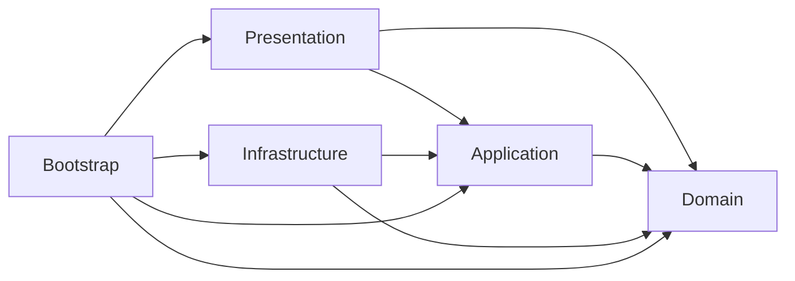

# Блинопёк — чистая архитектура

Актуализировано 15.10.2026. Документ задаёт целевое устройство проекта и порядок перехода. Правила игры — в [диздоке](GAME_DESIGN.md), текущие файлы, запуск и проверки — в [игровом коре](GAMEPLAY_CORE.md), обучение — в [прогрессии](PROGRESSION.md).

## Что уже есть

Unity-клиент содержит рабочую готовку, смены, обучение, магазин, звук и файловое восстановление. `Domain` и `Application` отделены сборками без `UnityEngine`; `DaySession` разделён на части, генератор заказов и журнал выделены отдельно. `AppBootstrap` собирает зависимости вручную. Сервер Node.js/Express + MariaDB пока обслуживает только авторизацию и `/health`.

**Целевой сетевой режим ещё не реализован:** сервер подтверждает прогресс и обе валюты; интернет нужен для начала смены и покупок. Выданную смену можно продолжить и закончить без сети, включая перезапуск приложения. Следующая смена доступна после синхронизации. Текущий `LocalDevelopmentGateway` — отдельный режим разработки.

## Слои и направление зависимостей

Стрелка означает ссылку в коде. Контракты внешних систем принадлежат внутреннему слою.

| Слой в `Assets/Blinopek` | Владеет | Ограничение |
| --- | --- | --- |
| `Domain` | Состояние смены, правила готовки, генерация, оценка и расчёт результата. | Чистый C#: без Unity, файлов, HTTP, SDK, времени устройства и текстов интерфейса. |
| `Application` | Начало/повтор/завершение смены, покупки, паузы, журнал, сохранение и синхронизация. | Вызывает Domain и объявляет интерфейсы хранилища/шлюзов; не знает реализаций. |
| `Presentation` | Экраны, ввод, отображение состояния, анимация, звук и локализованные сообщения. | Отправляет команды и читает данные; не меняет модель, деньги и сохранения напрямую. |
| `Infrastructure` | Файлы, HTTP, защищённое хранение токенов, доставка контента, адаптеры рекламы и магазинов. | Реализует контракты Application; не определяет цены, качество или прогрессию. |
| `Bootstrap` | Создание объектов, выбор окружения, запуск сцены и драйвер симуляции. | Единственное место связывания конкретных реализаций. |
| `Editor` | Авторский контент, экспорт, проверки ассетов и сборки. | Только редактор; runtime на него не ссылается. |

Сохраняем существующие `.asmdef`. Внутри слоя группируем код по обязанностям; интерфейс нужен на границе внешней системы или заменяемой политики. Глобальный сервис-локатор, универсальная шина событий и отдельная сборка для каждой сущности не нужны.

## Модель и правила

`DaySession` — единая точка изменения активной смены. Его `partial`-файлы упорядочивают код, но остаются одним классом. Внутренние модели не получают собственных хранилищ или независимого жизненного цикла.

| Объект | Ответственность |
| --- | --- |
| `DaySession` | Фаза смены, согласованное выполнение команд и связь кухни, заказа и расчётов. |
| Состояние кухни | Один блин на сковороде, один на тарелке, готовые порции; один экземпляр каждого блина по ID. |
| `OrderState` | Требования, принятие, ожидание, закреплённые порции, выдача/отмена и оценка. |
| `OrderGenerator` | Воспроизводимый выбор заказов из seed, профиля и закреплённого баланса. Текст просьбы не является рецептом. |
| `QualityEvaluator`, `Ledger` | Оценка и предварительные доходы/расходы; без внешних начислений. |
| Профиль и правила | Подтверждённый прогресс и неизменяемая для смены копия настроек. |

Обязательные инварианты:

- Готовка возможна до заказа и между гостями; сковорода и тарелка независимы. Уход гостя сохраняет начатые и готовые блины.
- Складывание завершает порцию. Только `ServeOrder` выдаёт весь поднос, в том числе пустой, неполный или с лишними порциями. Оценка и расчёт выполняются один раз.
- При закрытии новые заказы не принимаются; принятый завершается выдачей или отменой. Итог появляется после реакции и ухода гостя; невыданные заготовки удаляются.
- Неверное блюдо допускается и снижает качество. Обучение защищает только учебный блин; помощник использует обычные правила нанесения и расхода.
- Повторный мазок расходует продукт даже без роста покрытия. Маска и дозы определяют качество; сглаживание изображения их не меняет.
- Генератор учитывает доступные ингредиенты и формы. Прогрессия, история и сезон добавляют типизированные условия/эффекты через те же правила.

Автоматическая выдача сохраняется только при воспроизведении старых журналов; новые смены используют ручную выдачу.

Целевое изменение: закрыть публичную запись в профиль, списки и модели; выдавать представлению интерфейсы чтения либо отдельные проекции. `Feedback` и причины оценки заменить кодами с параметрами, русский текст перенести в Presentation. При переходе старый API остаётся фасадом для существующих экранов.

## Сценарии приложения, команды и время

Поток: **ввод → команда → проверка и изменение Domain → запись принятой команды → обновление проекции и живые события**. Отклонённая команда не попадает в журнал; сообщение об отказе может обновить представление. Воспроизведение не запускает звук, рекламу и внешние начисления.

`GameController` остаётся фасадом. По мере внедрения выделяются управление сменой, покупки, координация сохранений и синхронизация. `SessionJournal` отвечает только за журнал. Правила определяют результат операции, Application — её порядок и уведомления.

Целевые состояния приложения: `Loading → Ready → Playing → AwaitingSync → Ready`; несовместимая версия переводит в `UpdateRequired`. Они отделены от фаз смены `Serving → Closing → Result` и от выбранного экрана.

| Граница Application | Сейчас | Цель |
| --- | --- | --- |
| Сохранение | `IGameStore`, `IResettableGameStore` | Упорядоченные записи согласованного снимка; явные ошибки и миграции. |
| Смена | Локальный `IDayGateway.Settle` | Асинхронные начало, статус и подтверждение с ID операции; сетевые DTO отдельно от Domain. |
| Покупка | Изменение профиля в `Buy` | Отдельный сценарий; в сетевом режиме цена и выдача подтверждаются сервером. |
| Данные экрана | Изменяемый `Session` | Проекции для чтения и типизированные результаты команд. |

Один драйвер в Bootstrap переводит время Unity в тики по **50 мс**. Application проверяет составные причины паузы; Domain получает количество тиков. Меню, книга, фон и потеря фокуса не отменяют друг друга. Из фона нет догоняющей симуляции. Сетевые сроки и сезоны используют серверное время.

Координаты команд — целые `[0,1000]`; расход рассчитывается по пространственным шагам траектории. Порядок команд, округление, генератор и предел пачки `GameCommand.MaxTickCount` входят в контракт воспроизведения. Автоматические переходы сохраняют семантику старых журналов. Анимация не двигает часы и не подтверждает выдачу.

## Представление и время жизни

- `AppBootstrap` создаёт контроллер, адаптеры и драйвер один раз. `Bootstrap → Cafe` сохраняется; смена живёт независимо от экрана.
- `GameView` становится оболочкой навигации. Кухня, стойка, результат, магазин и настройки получают отдельные представления/презентеры; HUD читает общую проекцию.
- `KitchenInputRouter` владеет захватом указателя и переводом координат. UI не пропускает касание на кухню; потеря фокуса завершает жест на последней принятой точке.
- `PancakeGraphic`, `CookingMotion` и звук отображают модель. UI может блокировать жест из-за анимации, но правила допустимости остаются в Domain. Сопоставление событий со звуками относится к Presentation.
- Экран освобождает подписки, текстуры и эффекты при уничтожении. Переключение не пересоздаёт смену. Существующий uGUI сохраняется; замена рендера не является условием чистой архитектуры.

## Сохранение и совместимость

`SavedGame` — DTO хранения, а не игровая модель. Схема `1` сохраняет исходный профиль, правила, seed, команды, признак расчёта и название кафе. `FileGameStore` пишет временный файл, проверяет контрольную сумму и заменяет основную копию с резервной. Повреждение обеих копий или несовместимая версия блокируют перезапись.

Один координатор упорядочивает записи после важных действий, окончания жеста, периодически и при паузе. Частые штрихи показываются сразу; ошибка записи отмечает несохранённое состояние и допускает повтор. Сброс и переименование принимаются в памяти после успешной записи. Целевая локальная покупка также сохраняет подготовленный профиль до публикации успеха; сейчас `Buy` ещё меняет его до `Save`.

Сохраняем значения `ActionKind`, имена JSON-полей и старые журналы. `coins` — сотые златника, `honey` — целые жаринки; `Ingredient.Honey` — начинка. Переименование C#-типов не должно неявно менять DTO. Миграция воспроизводит старые правила, затем явно включает новый режим и записывает переход один раз.

Для сети добавляются владелец аккаунта, ID попытки, версии, квитанции и очередь отправки. Профиль, квитанция и очередь сохраняются согласованно. Смена аккаунта не смешивает прогресс; истёкший токен не удаляет попытку. Контрольная сумма обнаруживает повреждение, доверие к результату обеспечивает сервер.

## Сервер, синхронизация и экономика

Цель — модульный сервер Node.js/Express, одна MariaDB и фоновые обработчики. HTTP-обработчик проверяет формат/авторизацию и вызывает прикладной сценарий; тот использует правила и порты хранилища. SQL и SDK находятся в адаптерах. `server.js` собирает зависимости; `app.js` освобождается от прикладной логики.

Модули: `Identity`, `GameSessions`, `PlayerProgress`, `Economy`, `Catalog`, `Ads`, `Purchases`, `LiveOps`, `ContentReleases`. Чужие данные меняются через прикладной контракт; начисления проходят только через `Economy`. Общая транзакция может охватывать итог смены, кошелёк, инвентарь и прогресс.

**Решение для проверки симуляции:** .NET worker собирается из тех же исходников `Blinopek.Domain`, без Unity. Node обращается к нему через порт проверки с версионированным запросом/ответом. Worker получает серверный снимок, правила и команды, возвращает результат и не пишет кошелёк. Это убирает вторую реализацию готовки на JavaScript и тяжёлую работу из HTTP-цикла. Worker ещё предстоит создать; старые проверяющие версии сохраняются для активных попыток.

Протокол смены:

1. Сервер выдаёт одну активную попытку на аккаунт: ID, seed, исходный профиль, резерв средств/инструментов и версии симуляции, правил, контента. Клиент сохраняет её до разрешения ввода.
2. Команды идут ограниченными пакетами с последовательными номерами. Повтор безопасен; другое содержимое под прежним номером отклоняется. Квитанция подтверждает сохранение команд, не выдачу денег.
3. Без сети продолжается выданная смена. По окончании сохраняются пакет завершения и состояние `AwaitingSync`; повтор отправки использует тот же ключ.
4. Worker воспроизводит команды и проверяет переходы, ресурсы, размеры журнала и время. Итог, прогресс, расход и награды фиксируются сервером одной транзакцией. Клиентские суммы не являются основанием начисления.
5. Потерянный ответ восстанавливается запросом статуса/повтором с прежней квитанцией. Загрузка профиля не стирает очередь. Явная отмена на другом устройстве меняет поколение попытки; сетевой таймаут её не отменяет.

Экономические операции имеют уникальный источник и ключ повтора с хешем запроса. Обе валюты считаются целыми величинами; суммы API передаёт десятичными строками, сервер использует точный целочисленный тип. Цена берётся из серверного каталога. Списание, выдача и запись операции атомарны.

При успехе сервер освобождает резерв, проводит рассчитанную разницу и расход инструментов, повышает день. При неудаче резерв освобождается без переноса доходов/расходов попытки; день не повышается, флаги обучения сохраняются по правилам урока. Независимые покупки и рекламные награды аккаунта не откатываются. Продукты не списываются повторно при построении отчёта. Отрицательный предварительный итог не разрешает отрицательный постоянный кошелёк.

Реклама начинается с серверного intent и резерва лимита; награда выдаётся после проверки уведомления провайдера. Билет и просмотр — взаимоисключающие способы одного intent. Покупка магазина проверяется сервером, выдаётся один раз по внешнему ID и затем подтверждается у провайдера. Возвраты — отдельные корректирующие операции. Внешние вызовы выполняются вне SQL-транзакции; `inbox/outbox` обеспечивают повтор и сверку.

## Данные и API

Существующие `users` и `sessions` относятся к входу. Целевые группы: профиль с `revision`; кошельки/резерв; неизменяемые операции/проводки; инвентарь/владение; игровые попытки/пакеты команд; ключи повторов; рекламные intent/лимиты; транзакции магазинов; `inbox/outbox`; релизы, сезоны, награды и аудит. Единственность активной попытки и источника награды обеспечивается ограничениями БД.

`users.balance` не становится вторым игровым кошельком. Его смысл уточняется до миграции; перенос, если нужен, оформляется однократной проводкой с резервной копией БД.

| Целевая группа `/v1` | Операции |
| --- | --- |
| `bootstrap`, `player`, `catalog` | Совместимость, время, профиль, активная попытка и предложения. |
| `day-sessions` | Начало, пакеты команд, завершение, статус и явная отмена. |
| `shop/purchases`, `wallet/exchanges`, `player/actions` | Покупка, обмен и перечисленные в контракте изменения профиля. |
| `ads/intents` | Создание, статус и исполнение билетом. |
| `store/purchases`, `store/restore` | Проверка оплаты, статус и восстановление владения. |
| `seasons` | Участие, прогресс и однократное получение награды. |

Контракты описываются в `Contracts/openapi.yaml`, схемы/примеры — рядом. Владелец берётся из авторизации; доступ проверяется для каждого ID. `401` требует входа, `409` — разрешения конфликта, временные ошибки повторяются с тем же ключом и увеличением задержки. Проверка может вернуть `202`; клиент запрашивает статус. Пакеты имеют отдельные лимиты, общий JSON-лимит не снимается.

## Контент, сезоны и эксплуатация

ScriptableObject — авторские данные, прогресс хранится отдельно. Экспорт проверяет стабильные ID, ссылки, выполнимость рецептов/историй и выпускает правила для клиента и worker. Новые ID не зависят от файлов и переводов; существующие числовые ID сохраняются до явной миграции.

Версии разделены: `clientBuild` — код/SDK; `apiVersion` — сеть; `simulationVersion` — алгоритмы; `rulesVersion` — баланс; `contentVersion` — ассеты; `saveSchemaVersion` — сохранение; `seasonDefinitionVersion` — сезон. Попытка закрепляет свой набор. Новые алгоритмы требуют сборки, поддерживаемые рецепты и истории могут доставляться данными.

Для удалённых ассетов планируется Addressables/CDN. Манифест содержит совместимость, размеры, хеши и подпись; релизы неизменяемы. Сначала загружаются и проверяются файлы, затем переключается версия для новых смен. Откат публикации не меняет начатые попытки; их ресурсы и ресурсы купленного декора сохраняются. Публикация проходит экспорт, тестовое окружение, ограниченный выпуск и расширение; действия оператора журналируются.

Сезон проходит `Scheduled → Active → ClaimOnly → Archived` по серверному UTC. Основной прогресс сохраняется; сезонный начисляется по подтверждённым источникам. Награда уникальна по игроку/сезону/ID. Начатая в активном сезоне смена сохраняет визиты; обычный итог принимается независимо от окончания, сезонный зачёт — до заранее объявленного `claimUntil`. Постоянный декор остаётся у игрока.

Разработка, проверка и production имеют отдельные БД и настройки. HTTP использует TLS; токены хранятся защищённым адаптером, секреты провайдеров — на сервере. Логи содержат ID запросов/сессий/операций без токенов и платёжных данных. Контролируются ошибки восстановления, зависшие подтверждения, сверка кошельков и повтор фоновых задач. Бэкапы проверяются восстановлением.

Мобильная цель — устойчивые 60 FPS, допустимые 30 FPS на согласованных слабых устройствах; это требует измерений. Проверяются частые обновления Canvas, выделения памяти, текстуры и загрузка экранов. Подтверждение производительности — профиль на устройстве.

## Порядок перехода и критерии готовности

| Шаг | Изменение | Готово, когда |
| --- | --- | --- |
| 1 | Закрыть изменение модели из UI; вынести тексты и звуковые соответствия из внутренних слоёв. | Представление только читает данные и отправляет команды; журналы воспроизводятся без расхождений. |
| 2 | Вынести драйвер времени из `GameView`, разделить экраны и подписки. | Переключение/пересоздание экрана не меняет смену, паузы и незавершённые действия. |
| 3 | Выделить сценарии покупок и сохранения из фасада. | Ошибка записи не публикует успешную покупку; перезапуск/повтор не дублирует изменения. |
| 4 | Добавить сетевые контракты, общий C# worker, попытки, резерв и очередь синхронизации. | Завершение без сети, перезапуск и потеря ответа дают ровно одно подтверждение результата. |
| 5 | Подключить удалённый контент, затем рекламу/покупки и сезоны. | Проверены старая смена, повтор уведомлений, возврат и границы сезона. |

Меняем по одной границе через существующий фасад, без одновременной смены формата сохранений и игровых правил. Перенос Unity-ассетов сохраняет `.meta`/GUID. Текущие каталоги остаются; при сетевом этапе добавляются `Contracts/`, серверные модули и `ServerPart/SimulationWorker/`.

Обязательные проверки: `.asmdef` не допускают обратных ссылок; Domain/Application собираются без Unity; общие сценарии идут через .NET и Unity; старые сохранения проходят миграцию; UI проверяет жесты/навигацию; серверные тесты проверяют транзакции, повторы и сбои. При изменении симуляции сверяются одинаковые журналы и ожидаемые результаты клиента/worker.

До соответствующего этапа уточняются: программа обучения и баланс ([открытые вопросы](OPEN_QUESTIONS.md)), устройства/магазины, рекламный провайдер, сроки поддержки попыток и сезонного зачёта, возврат уже потраченной валюты. Эти параметры не меняют границы слоёв.

## Загрузка приложения и смены (29.10.2026)

Запуск и переходы смены используют постоянный экран загрузки: асинхронная загрузка ресурсов и сцены, фоновое чтение сохранения, порционное восстановление журнала и подготовка атласа/UI. Конфигурация загрузки отделена в JSON, тяжёлый контент разрешается по уникальному текстовому ключу через ScriptableObject-каталог. Игровой баланс остаётся в существующем GameContent. Подробности реализации, обработки ошибок и ограничения проверок — в [документе о загрузке](LOADING.md).
