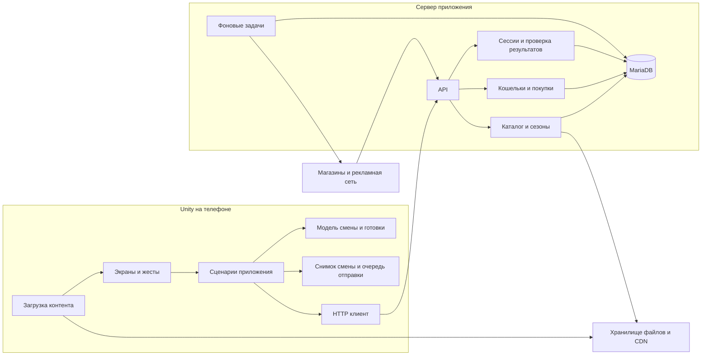
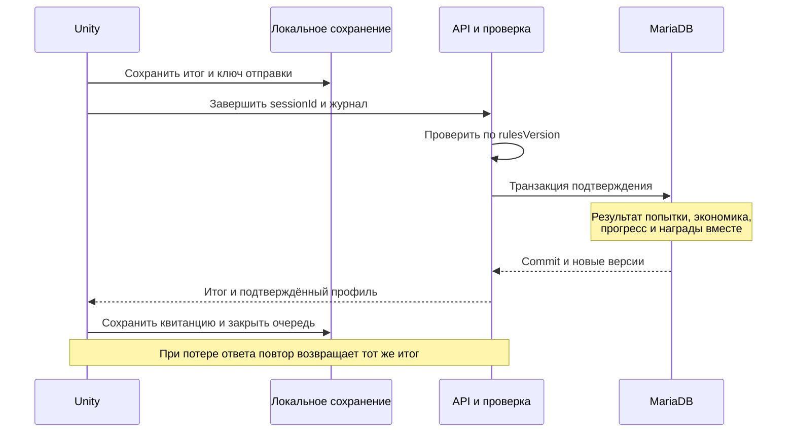

# Архитектура Блинопёка на Unity

Проект архитектуры от 14.10.2026. Основание: [диздок](GAME_DESIGN.md), [прогрессия и обучение](PROGRESSION.md), [2D-ассеты](ART_ASSETS.md) и уточнения пользователя о сервере, обновлениях и сезонном контенте.

**Unity выполняет готовку и показывает предварительный результат. Сервер подтверждает прогресс, ведёт обе валюты, проверяет рекламные награды и покупки, управляет версиями контента и сезонами.** Интернет требуется для начала и подтверждения смены. При обрыве связи уже начатую смену можно закончить и сохранить на устройстве; новая смена начинается после синхронизации. Это выбранный пользователем режим работы.

Предлагается модульное приложение Unity и модульный сервер Node.js/Express с MariaDB. Граница между ними проходит по игровой сессии и экономическим операциям. Покадровая готовка не требует сетевых запросов. Числовой баланс остаётся в конфигурациях для будущей настройки.

## Исходное состояние проекта

| Часть | Что уже есть | Что предстоит построить |
| --- | --- | --- |
| Unity | Редактор `6000.6.5f1`, URP `17.6.0`, Input System `1.20.0`, uGUI `2.6.0`, Test Framework `1.8.0`. Стартовая 2D-сцена и код приветствия. | Игровое ядро, представление кухни, экраны, сохранение сессии, сетевые адаптеры. |
| Сервер | Node.js, Express, MariaDB; `/health`, регистрация, вход, текущий пользователь, выход. | Игровые сессии, прогресс, кошельки, каталог, реклама, покупки, сезоны и публикация контента. |
| База | `users`, `sessions`; у пользователя есть одно поле `balance`. | Две валюты, журнал операций, инвентарь, прогресс и остальные таблицы ниже. |

Версии взяты из [ProjectVersion.txt](../UnityPart/PancakeCooker/ProjectSettings/ProjectVersion.txt) и [manifest.json](../UnityPart/PancakeCooker/Packages/manifest.json). Addressables, рекламный SDK и IAP в manifest пока отсутствуют; их совместимые версии нужно закрепить при интеграции. Все имена новых классов, таблиц и маршрутов ниже обозначают проектируемые компоненты.

Сезоны и серверное хранение входят в объём по новому уточнению пользователя. Доставка, сад и социальные функции остаются за его пределами. Содержание конкретного сезона определяется отдельно; архитектура поддерживает сезонных гостей, рецепты, оформление, условия прогресса и награды.

## Общая схема



API и фоновые задачи используют одну кодовую базу и одну транзакционную БД. Для начала достаточно одного сервиса API, одного процесса фоновых задач и файлового хранилища с CDN. Разделение на независимые сервисы потребуется только при измеренной нагрузке или отдельной ответственности команды.

| Данные или действие | Кто определяет результат |
| --- | --- |
| Касания, анимация, звук, изображение блюда | Unity. |
| Ход готовки и предварительная оценка | Локальное ядро по закреплённым правилам смены. |
| Итог смены, полученные деньги, открытия и сюжетные последствия | Сервер после проверки последовательности действий. |
| Состав заказа, цены, допустимые покупки, награды | Серверная версия каталога и правил. Клиент получает её копию. |
| Рекламные лимиты, активность сезона, срок предложения | Время и данные сервера. |
| Реальная покупка | Подтверждение магазина, проверенное сервером. |
| Локальный файл | Восстановление незавершённой сессии и кэш подтверждённого профиля. |

## Устройство Unity клиента

### Слои и зависимости

| Сборка | Ответственность | Зависимости проекта |
| --- | --- | --- |
| `Blinopek.Domain` | Модели смены, заказа, блина; правила готовки, оценки и предварительной экономики. | Нет. Обычный C#, без `UnityEngine`. |
| `Blinopek.Application` | Начало и завершение смены, обработка команд, обучение, синхронизация, интерфейсы внешних систем. | Domain. |
| `Blinopek.Presentation` | MonoBehaviour, экраны, жесты, анимации, отрисовка, редакторские ScriptableObject и преобразование их в определения Domain. | Application, Domain. |
| `Blinopek.Infrastructure` | HTTP, локальные файлы, Addressables, адаптеры рекламы, магазина и платформенного хранилища токенов. | Application, Domain. |
| `Blinopek.Bootstrap` | Создание объектов и передача зависимостей между слоями. | Остальные четыре сборки. |

Domain и Application собираются с запретом ссылок на Unity Engine. Внутри слоёв код сгруппирован по системам: `Day`, `Orders`, `Cooking`, `Economy`, `Progression`, `Story`, `Tutorial`, `LiveOps`. Отдельная сборка на каждый ингредиент или экран не нужна.

Зависимости передаются через конструкторы обычных классов и явную инициализацию компонентов. На старте достаточно ручной сборки объектов в `AppBootstrap`. Общий статический `GameManager`, поиск сервисов из любого места и контейнер зависимостей не нужны для этого масштаба.

### Сцены и время жизни

Достаточно двух сцен:

- `Bootstrap` — конфигурация окружения, локальное восстановление, авторизация, проверка совместимости, получение профиля и контента. Один постоянный `AppRoot` владеет сетевыми и платформенными адаптерами.
- `Cafe` — стойка и кухня как отдельные корневые объекты, общий HUD, книга рецептов, итог дня, развитие, отзывы и настройки как панели. Переключение кухни и стойки не пересоздаёт смену.

`DaySessionScope` создаётся при получении серверной сессии и уничтожается после её окончательного подтверждения либо отмены. Он владеет симуляцией, журналом команд и подписками текущей смены. `View` можно пересоздать из состояния; уничтожение объекта сцены не завершает заказ.

У приложения отдельные состояния `Loading`, `Ready`, `Playing`, `AwaitingSync`, `UpdateRequired`. `AwaitingSync` показывает сохранённый итог и повторяет отправку после восстановления связи. Выход из приложения разрешён: результат уже лежит на диске.

### Направление обработки действий

```text
Касание → распознавание жеста → игровая команда
        → проверка состояния → изменение модели и журнала
        → уведомление представления → анимация и звук
```

Основные команды: `AcceptOrder`, `ClarifyOrder`, `ApplyBatterStroke`, `FinishBatter`, `FlipPancake`, `MoveToPlate`, `ApplySpreadStroke`, `PlaceIngredientPortion`, `RemoveIngredientType`, `DiscardPancake`, `ApplyFoldGesture`, `FinalizeFold`.

Команды и результаты SDK поступают в одну последовательную очередь Application. Представление получает снимки для чтения и типизированные уведомления. Обработчики событий UI не начисляют валюту и не запускают скрытые цепочки изменения модели. Завершение анимации может открыть ввод, но не является условием выдачи оплаты или сохранения заказа.

### Модель данных

| Модель | Основные данные и владелец |
| --- | --- |
| `ProfileSnapshot` | Подтверждённые сервером дни, покупки, формы, навыки, истории, рейтинг и декор; версия профиля. |
| `WalletSnapshot` | Две подтверждённые суммы, доступные и зарезервированные средства, версия кошелька. |
| `DaySession` | Серверный ID попытки, номер дня, состояние, начальный снимок, seed, версии правил, время симуляции, очередь визитов, журнал расходов. |
| `VisitorState` | Посетитель у стойки, фаза диалога, ожидание. Лояльность текущего заказа не переносится в профиль. |
| `OrderSpec` | Неизменяемые требования: список порций, их начинки, исключения, нормы и форма; исходная реплика и уточнения. |
| `OrderState` | ID заказа, принятие, предварительная оплата, готовые блины, состояние выдачи/отмены, результат оценки. |
| `PancakeState` | ID, принадлежность заказу, этап, маска теста, обе стороны прожарки, слои начинок, порции и сгибы. |
| `KitchenState` | Занятость сковороды и тарелки, выбранный инструмент, ID активного блина. |
| `QualityReport` | Отдельные оценки состава, количества, дырок, прожарки, формы и ожидания; причины штрафов. |
| `SessionProjection` | Предварительный баланс, расход скребков, сюжетные и учебные изменения текущей попытки. |

Сковорода, тарелка и список готовых порций ссылаются на один экземпляр состояния блина по ID. Они не хранят независимые копии состава. Первый рабочий вариант использует одну сковороду и одно место сборки; расширение числа станций вводится только вместе с соответствующей механикой.

### Правила состояний

```text
День: Opening → Serving → Closing → ResultPending → ConfirmedSuccess → Shopping
                                                      └→ ConfirmedFailure → Retry
Заказ: Offered → Accepted → Preparing → Served
                      └──────────────→ Cancelled
Блин: ApplyingBatter → FryingSideA → FryingSideB → OnPlate → Folding → Finished
```

`Closing` запрещает новые приёмы, но позволяет закончить уже принятый заказ. Если активного заказа нет, можно сразу формировать итог. Гость, с которым ещё не заключён заказ, после закрытия не создаёт новую оплату. Уход по исчерпанию терпения завершает заказ отменой и единственным возвратом; приготовленные для него блюда очищаются с сохранением расходов.

Условия, которые проверяются в модели:

1. У стойки один активный заказ; в нём может быть несколько разных блинов.
2. Начинка наносится на тарелке. Перенос разрешён после готовности второй стороны; подгоревшая сторона не запрещает перенос и выдачу.
3. В обычной игре оценка учитывает фактический результат. Неправильная форма или состав не блокируют выдачу. Первый безопасный урок повторяет ошибочный шаг до принятого результата, согласно `TutorialPolicy`.
4. Скребок действует до начала складывания: одно применение удаляет весь выбранный тип начинки и расходует один инструмент. Потраченные продукты не возвращаются.
5. Сложенный блин неизменяем. Когда число завершённых порций достигает количества из заказа, `FinalizeFold` последнего блина в той же логической операции завершает заказ и рассчитывает его результат.
6. Повтор команды завершённого заказа возвращает существующий результат. Не создаются вторые чаевые, отзыв, возврат или расход скребка.

Если игрок готовит разные порции в другом порядке, оценщик сопоставляет готовые блины требованиям с наилучшим суммарным соответствием. Номер приготовления сам по себе не даёт штраф. Это предлагаемое правило сопоставления, которое следует проверить на игровых примерах.

### Время и пауза

`SimulationClock` двигает жарку, терпение, рабочие часы и интервалы гостей. Один драйвер обновляет его с фиксированным шагом; жесты собираются на частоте кадров и переводятся в последовательность нормализованных команд. Шаг, округление и порядок обработки входят в `rulesVersion`.

Сначала симуляция доходит до времени команды, затем применяется команда; все переходы на границах времени имеют одинаковые правила на сервере и клиенте. Логика готовки не зависит от длительности анимации или числа вызовов `Update`.

При сворачивании симуляция останавливается; время вне приложения не дожаривает блин и не уменьшает терпение. Отдельный `PauseController` учитывает причины паузы: приложение в фоне, меню, системный экран, учебный шаг. Снятие одной причины не снимает остальные. Для книги рецептов и диалоговых подсказок режим паузы задаётся явной политикой; предлагается пауза при чтении книги.

`ServerClock` используется для сезонов, лимитов рекламы и срока предложений. Локальная копия времени нужна для обратного отсчёта; сервер всё равно заново проверяет срок при операции.

## Готовка и мобильный ввод

### Тесто и намазываемые начинки

Рабочая поверхность задаётся в нормализованных координатах блина, независимо от разрешения экрана. Стартовый технический вариант — сетка покрытия `128 × 128`; размер проверяется на устройствах. Траектория интерполируется с постоянным пространственным шагом, чтобы редкие события касания не оставляли случайных разрывов.

Модель хранит отдельно покрытие и израсходованное количество. Повторное проведение по заполненному участку может увеличить расход без увеличения площади. Стоимость зависит от принятой дозы, а не от количества кадров или сообщений ввода. Радиус, подача, ограничение слоя и округление дозы задаются правилами; выбор этой модели расхода является проектным решением для прототипа.

Отрисовка получает ту же маску, которую использует оценщик. Для каждого намазываемого типа есть отдельная маска, для теста — отдельная маска дырок. Отображение можно сглаживать, но оно не меняет логические данные. На GPU передаются только изменённые области; постоянное чтение RenderTexture обратно на CPU не требуется.

Момент перехода от нанесения теста к жарке в диздоке не определён. Предлагается явная команда `FinishBatter`, которую прототип может вызывать кнопкой завершения нанесения. Она не требует идеального покрытия: дырки остаются частью качества. Окончательный жест или элемент интерфейса нужно выбрать после проверки удобства.

### Прожарка и складывание

Обе стороны хранят накопленное время воздействия нагрева отдельно. `CookingRules` переводит его в состояния «сырая», «готовая», «подгоревшая». До переворота нагревается первая сторона, после — вторая. После переноса на тарелку нагрев прекращается. Ранний переворот сохраняет недожаренную первую сторону, поздний — подгоревшую.

Складывание реализуется как последовательность распознанных жестов для треугольника, конверта и трубочки. Физическая симуляция ткани для первой версии не требуется. Модель хранит реально выполненные сгибы, а представление анимирует их масками и слоями. `FinalizeFold` фиксирует полученную форму, включая ошибочную; достижение идеальной формы не является единственным путём завершения. Конкретный способ завершить ошибочное или неполное складывание нужно определить при прототипировании ввода.

### Порции и помощники

Творог и грибы представлены порциями с координатой, типом и дозой. Трафарет является подсказкой. Ошибочное размещение допускается и оценивается по расстоянию, количеству и распределению; незаметное автоматическое исправление всех действий убрало бы часть ручной механики.

Ручное нанесение и помощник используют один расчёт дозы и цены. Помощник генерирует корректную последовательность нанесения для выбранной начинки; он не выбирает весь рецепт за игрока. У каждого помощника отдельные признаки владения и включения.

### Представление и управление

Для рисованной кухни использовать SpriteRenderer и небольшое число материалов URP 2D; для экранов — uGUI и текст с поддержкой кириллицы. Интеграция uGUI с Input System проходит через `InputSystemUIInputModule`. Это соответствует [документации Input System](https://github.com/Unity-Technologies/InputSystem/blob/develop/Packages/com.unity.inputsystem/Documentation~/using-ui-input-module.md).

`KitchenInputRouter` выбирает цель касания и закрепляет `pointerId` до окончания жеста. Касание UI не проходит на сковороду. Для первого варианта одновременно принимается один кухонный жест; второй палец не меняет ингредиент посреди нанесения. Координаты учитывают safe area, масштаб и преобразование поверхности. При потере фокуса активный жест завершается на последней принятой точке, без выдуманного движения пальца.

Покрытие, прожарка, начинки и сгибы отображаются раздельно, как предусмотрено списком ассетов. Дырки сохраняются при переносе и складывании. При восстановлении сессии визуальные маски строятся из модели. Предлагаемая ориентация первого прототипа — горизонтальная; это ещё не согласованное продуктовое требование.

## Контент, развитие и обучение

Авторские данные оформляются ScriptableObject: `IngredientDefinition`, `RecipeDefinition`, `FoldDefinition`, `VisitorDefinition`, `StoryDefinition`, `UpgradeDefinition`, `DecorDefinition`, `TutorialDefinition`, `ProgressionDefinition`, `SeasonDefinition` и `BalanceConfig`. Редакторский экспорт выпускает единый проверенный JSON-набор правил для сервера и клиента, а визуальные ресурсы собираются отдельно.

У каждой сущности стабильный ID, например `ingredient.butter`. Имя файла, индекс в массиве и текст перевода не являются идентификаторами сохранения. Удаление используемого ID требует совместимой замены или миграции. Данные ScriptableObject служат авторским каталогом; изменяемый прогресс сохраняется отдельно. Unity описывает эти объекты как [ресурсы данных для разработки и чтения в собранном приложении](https://docs.unity3d.com/6000.0/Documentation/Manual/class-ScriptableObject.html).

Генератор сначала создаёт точный `OrderSpec`, затем выбирает формулировку просьбы. Текст не разбирается обратно в рецепт. Обычные заказы используют купленные ингредиенты и доступные по политике прогрессии формы. Доступность товара для покупки отделена от владения. Сюжетный заказ тоже проходит проверку выполнимости; нужный учебный доступ должен быть явно задан сценарием.

`ProgressionEvaluator` проверяет типизированные условия: завершённый день, освоенный навык, владение продуктом, флаг истории, этап сезона. По актуальному документу прогрессии одна смена равна одному уровню: номер уровня выводится из номера дня, повтор не повышает его. Навыки и этапы истории хранятся отдельно. Фирменный рецепт сохраняется как комбинация стабильных ID и становится доступным генератору после проверки состава.

`StoryRunner` работает с узлами диалога, условиями и ограниченным набором эффектов: установить флаг, предложить заказ, открыть контент, назначить следующую встречу. Денежные эффекты подтверждаются серверной экономикой. Произвольный код в загружаемых историях не выполняется.

`TutorialRunner` слушает результаты обычных игровых команд и показывает одну текущую цель. `TutorialPolicy` реализует согласованный безопасный заказ «Первый блин комом»: демонстрационная порча, удаление блина в мусорку, повтор без денежных потерь и снижения терпения, пауза при чтении, удержание готовности второй попытки и повтор неверного жеста складывания. Успешный заказ оплачивается один раз. Следующий заказ использует обычные правила.

Для демонстрации используется тот же расчёт нагрева с отдельным учебным продвижением времени только текущего блина; остальные часы остановлены. Удаление учебной пробы освобождает сковороду, сохраняя заказ. Учебное состояние и выполненный шаг входят в сохранение и серверную проверку. Сервер сам назначает разрешённую политику урока в начальном снимке: клиент не может включить бесплатный расход в произвольной смене. Порядок дальнейших открытий и внешний вид сигнала готовности остаются в [списке вопросов](OPEN_QUESTIONS.md).

Валидатор контента проверяет уникальность ID, ссылки рецептов, совместимость форм, доступность нужных ресурсов, достижимость обязательных шагов, отсутствие обязательной покупки помощника и корректность наград. Цены, тайминги и пороги не зашиваются в MonoBehaviour.

## Серверные модули

Сохраняется текущая основа Node.js/Express + MariaDB. Для новых модулей предлагается TypeScript с постепенным подключением к существующему коду. Сервер остаётся одним приложением с явными границами:

| Модуль | Ответственность |
| --- | --- |
| `Identity` | Аккаунт, вход, сессии доступа, устройства и привязка запросов к пользователю. |
| `PlayerProgress` | Подтверждённые дни, навыки, открытия, истории, рейтинг и версия профиля. |
| `GameSessions` | Выдача попытки, начальный снимок, приём команд, проверка, подтверждение или отмена смены. |
| `Economy` | Кошельки, резерв средств, журнал начислений и списаний, атомарные операции. |
| `Catalog` | Цены, предложения, условия покупки, улучшения, ингредиенты и декор. |
| `Ads` | Предложения рекламы, лимиты, проверка уведомлений сети и выдача наград. |
| `Purchases` | Проверка транзакций магазинов, выдача товаров, восстановление и возвраты. |
| `LiveOps` | Сезоны, расписания, условия участия, сезонный прогресс и награды. |
| `ContentReleases` | Версии правил, манифесты ресурсов, совместимость клиента и публикация. |
| `Operations` | Повторы фоновых операций, сверка покупок, наблюдаемость и служебные инструменты. |

Модули вызывают прикладные методы друг друга, не меняют чужие таблицы напрямую. Начисление любой награды проходит через `Economy`. Доступ к БД скрыт за репозиториями и транзакциями. Общая транзакция может охватывать несколько модулей, например подтверждение дня и сезонного этапа.

Медиафайлы хранятся в объектном хранилище и отдаются через CDN. MariaDB хранит метаданные и ссылки, а API не раздаёт большие текстуры. Отложенные операции сначала можно выполнять worker-процессом из таблиц `inbox`/`outbox`; отдельная очередь сообщений и Redis не обязательны для первой версии.

## Протокол игровой смены

### Начало

1. Клиент получает совместимые правила, загружает обязательные ресурсы и подтверждённый профиль.
2. `POST /v1/day-sessions` с ключом повторной операции запрашивает начало смены. Сервер проверяет версию профиля, доступность дня и отсутствие другой активной попытки аккаунта.
3. Сервер фиксирует `sessionId`, `dayNumber`, `attemptNumber`, `deviceId`, `seed`, начальный снимок, `simulationVersion`, `rulesVersion`, `contentVersion` и условия сезонного участия. Создаёт резерв экономики и возвращает сессию.
4. Клиент надёжно сохраняет сессию на диск и только затем разрешает готовку. Если ответ потерялся, повтор с тем же ключом возвращает ту же попытку.

Для одного аккаунта одновременно существует одна изменяемая игровая попытка. Второе устройство видит её статус. Перенос возможен из уже загруженной контрольной точки; незагруженные действия первого телефона нельзя восстановить с сервера. Принудительная отмена требует явного выбора игрока и увеличивает поколение сессии: старый телефон после этого не может подтвердить отменённую попытку.

### Игра и обрыв связи

Клиент пишет нормализованные команды с `sequenceNumber` и временем симуляции. При наличии сети пакеты отправляются после заказов и контрольных точек; при отсутствии остаются в локальной очереди. Квитанция сервера содержит последний непрерывно принятый номер команды. Повтор пакета с тем же номером и содержимым безопасен; другой текст под тем же номером отвергается.

Серверное получение пакета означает сохранение черновика, а не начисление денег. Клиент показывает предварительный баланс смены сразу: оплата при принятии, расход при использовании, чаевые и возвраты при результате. В подтверждённый кошелёк эти операции переходят при окончательном расчёте смены.

После завершения без сети клиент сохраняет неизменяемый пакет `FinishSession` и переходит в `AwaitingSync`. Доступны итог и настройки; новый день, развитие, обмен валют и новые рекламные награды требуют связи. Перезапуск приложения восстанавливает ожидание отправки. Окончание срока токена входа не удаляет попытку: после повторного входа в тот же аккаунт отправка продолжается.

### Проверка на сервере

Сервер воспроизводит существенные правила по собственному начальному снимку, seed, закреплённому каталогу и присланным командам. Он заново получает заказы, расход, оценку, чаевые, возвраты, аренду и изменения прогресса. Поля клиента вроде `earnedCoins`, `quality = 100` или `seasonCompleted = true` не принимаются как основание награды.

Для C# и TypeScript поддерживаются общие тестовые наборы входных команд и ожидаемых результатов. Формат координат, доз, случайных чисел, времени и округления задан явно. В проверяемой части используются целочисленные величины; seed и сериализуемое состояние генератора восстанавливаются одинаково. JS `Number` не используется для денежных значений за пределами безопасного диапазона; в API целые суммы передаются десятичными строками, на сервере обрабатываются через `BigInt` или эквивалентный точный тип.

Проверяются допустимость переходов, число порций, владение ингредиентами, расход скребков, порядок команд, границы траекторий, длительность жарки и предельный размер журнала. Продолжительность симуляции сверяется с временем от выдачи сессии на сервере с учётом разрешённого ускорения и допуска: присланные будущие ticks не позволяют мгновенно завершать длинные смены. Траектории квантуются и ограничиваются по частоте ещё на клиенте; сервер повторяет ограничения. Тяжёлая проверка выполняется worker-процессом, чтобы не блокировать Express.

Такая проверка защищает экономику от произвольных сумм и невозможных действий, но не доказывает, что допустимую траекторию нарисовал человек. Защита от автоматизированной идеальной игры — отдельная задача, особенно при будущем соревновательном режиме.

### Подтверждение



Финальная транзакция блокирует строку сессии и нужные строки экономики, ещё раз проверяет состояние попытки и атомарно сохраняет результат. Повтор завершённой сессии читает уже записанный итог. Проверка может отвечать `202 Processing`; клиент узнаёт статус через отдельный запрос с увеличением интервала повторов.

Короткий таймаут HTTP или отсутствие heartbeat не отменяют офлайн-попытку. Обычная смена восстанавливается по своему ID. Неиспользуемые попытки можно явно отменять; версии правил сохраняются, пока для них существуют возобновляемые сессии. Политику долгосрочного хранения нужно определить перед запуском эксплуатации.

## Экономика и повтор дня

### Кошельки и журнал

Обе валюты хранятся как целые величины в минимальных игровых единицах. У операции есть `operationId`, пользователь, тип, причина, источник, валюта, сумма и время сервера. Одна экономическая операция объединяет все связанные записи: например списание премиальной валюты и начисление обычной при обмене.

Сервер вычисляет цену по ID предложения и его версии. Клиент не присылает доверенную цену или новый баланс. Покупка проверяет доступность, владение, условия и остаток; списание и выдача содержимого проходят в одной транзакции. Повторное открытие уже купленного постоянного товара не списывает цену.

Каждый изменяющий запрос содержит `Idempotency-Key`, создаваемый один раз до отправки. В БД уникальны пользователь, операция и ключ; сохраняются хеш запроса и результат. Повтор возвращает прежний ответ. Тот же ключ с другим содержимым даёт конфликт. Дополнительно защищаются сами бизнес-источники: ID смены, транзакция магазина, рекламное событие и награда сезона. Новый HTTP-ключ не позволяет получить их второй раз.

### Как отделить смену от постоянных денег

На старте сервер резервирует доступную обычную валюту и используемые в смене расходуемые инструменты. Баланс активной попытки вычисляется из этого снимка плюс доходы минус расходы. Платёжные покупки могут независимо пополнять постоянный кошелёк, но новые пополнения не меняют уже закреплённый бюджет смены. Обычные покупки развития, обмен и расход рекламных билетов выполняются между сменами.

При успешном результате сервер снимает резерв, проводит рассчитанные операции и переносит изменения профиля в постоянное состояние. При финансово неудачном результате резерв возвращается, изменения попытки не переносятся, а номер дня остаётся прежним. Потраченные в неудачной попытке скребки восстанавливаются вместе с её исходным состоянием. История неудачи может оставаться в отчётах сервера.

Это даёт повтор дня из [диздока](GAME_DESIGN.md) без перезаписи всего аккаунта старым сохранением. Купленная за реальные деньги валюта, платный декор и уже подтверждённые рекламные награды не входят в откат смены. Входящая покупка во время офлайн-игры добавляется к постоянному кошельку независимо от расчёта попытки.

Предварительный результат может показать нехватку обычных денег после обязательных расходов; это условие неудачи, а не разрешение отрицательного постоянного баланса. Проверка возможности очередного расхода внутри смены должна быть согласованной частью `EconomyRules`, чтобы клиент и сервер одинаково обрабатывали нехватку средств.

### Отчёт

```text
Прибыль = выручка + чаевые − возвраты − продукты − аренда − оплаченный ремонт
```

Покупки развития и скребков показываются отдельно, как в диздоке. Отчёт строится по операциям, связанным с экономическим днём, и не списывает продукты второй раз. Для ремонта между сменами явно указывается день отчёта; один платёж не включается одновременно в две смены.

Рекламное увеличение чаевых является отдельной подтверждённой операцией с ссылкой на зафиксированный итог. Изменение экрана отчёта не пересчитывает рекламную награду. Премиальная валюта не начисляется обычной готовкой; её источники определяет каталог наград и покупок.

## Реклама и реальные покупки

### Рекламные награды

1. Сервер создаёт `AdRewardIntent`: пользователь, placement, конкретная награда, срок, окно суточного лимита и одноразовый ID. Сумма известна игроку до просмотра. Для бонуса чаевых основанием служит подтверждённый результат смены.
2. Unity передаёт непрозрачный ID в поддерживаемое SDK поле и запускает ролик.
3. Клиентский callback переводит интерфейс в «Награда подтверждается». Он не изменяет подтверждённый кошелёк.
4. Сервер получает уведомление рекламной сети, проверяет подпись, источник, ID события, связь с intent и условия показа; атомарно отмечает выполнение и начисляет награду.
5. Клиент получает новый кошелёк при запросе статуса. Задержка callback не останавливает обычную игру.

Например, AdMob предоставляет [подписанные server-side callbacks с ID транзакции и пользовательскими данными](https://developers.google.com/admob/unity/ssv?hl=en). Конкретную рекламную сеть ещё предстоит выбрать; обязательное требование к адаптеру — подтверждение на сервере. Это проектный выбор: награда становится расходуемой после проверки сервера.

Суточное окно определяется сервером; предлагаемый единый часовой пояс сброса — UTC. При выдаче intent резервируется место в лимите; завершение расходует его. Срок запуска просмотра и срок ожидания подтверждения различаются: резерв не освобождается до окончания окна проверки. Поздний callback проверяется по времени события провайдера и сохранённому intent, а не только по времени получения. После закрытия окна проверки спорное уведомление отправляется на сверку, не создавая новую выдачу сверх лимита. Повторы и события не по порядку не создают новую награду.

Билет пропуска рекламы потребляется сервером в той же транзакции, что и выдача соответствующей награды. Для одного intent возможен ровно один способ исполнения: просмотр либо билет. При уже запущенном просмотре переключение на билет блокируется до разрешения intent. Возврат дня не восстанавливает потраченный билет и не убирает его награду.

### Покупки через магазин

Unity IAP или адаптер выбранного магазина принимает пользовательское действие и передаёт подтверждение серверу. Сервер проверяет магазин, приложение, окружение, SKU, состояние оплаты и принадлежность операции аккаунту; находит содержимое товара в собственном каталоге. Идентификатор покупки уникален глобально в рамках магазина и окружения, чтобы другой аккаунт не мог присвоить ту же покупку.

Выдача содержимого и запись о её выполнении атомарны. После надёжной серверной фиксации выполняется подтверждение/завершение покупки в магазине. Состояния `Pending`, `Verified`, `Granted`, `AcknowledgementPending`, `Completed`, `Rejected`, `Refunded` сохраняются, поэтому обрыв связи не теряет процесс. Семантика повторного вызова и подтверждения описана в [документации Unity IAP](https://docs.unity.com/en-us/iap/purchases).

Адаптер магазина определяет, кто выполняет acknowledgement или consume: серверный worker либо SDK клиента после серверной выдачи. Для каждого провайдера назначается один основной исполнитель и механизм сверки. Google рекомендует [проверять токены и предоставлять содержимое через защищённый backend](https://developer.android.com/google/play/billing/security).

Уведомления магазинов сохраняются в `inbox` до обработки. Worker проверяет их, сверяет зависшие покупки и повторяет внешние запросы. Для Apple используется проверка подписанных уведомлений, описанная в [App Store Server Notifications V2](https://developer.apple.com/documentation/AppStoreServerNotifications/receiving-app-store-server-notifications). Провайдеры Google и Apple приведены как варианты для соответствующих площадок; окончательный список магазинов ещё не выбран.

Постоянный декор восстанавливается по серверным правам владения и данным магазина. Расходуемая валюта и билеты восстанавливаются по серверному журналу: повтор чтения истории магазина не начисляет их снова. Возврат покупки создаёт корректирующую операцию со ссылкой на исходную; обработка уже потраченной валюты требует отдельной политики задолженности или ограничений. Удалять исходную запись покупки нельзя.

## Обновления и сезонный контент

### Версии

| Версия | Что меняет | Как доставляется |
| --- | --- | --- |
| `clientBuild` | C# код, новые жесты, компоненты, SDK, шейдерные возможности. | Обновление приложения через выбранную площадку. |
| `apiVersion` | Контракт запросов и ответов. | Совместимый серверный выпуск; переход клиента при необходимости. |
| `simulationVersion` | Алгоритмы симуляции, распознавания и оценки; правила их воспроизведения. | Код клиента и соответствующий серверный проверяющий модуль. |
| `rulesVersion` | Цены, параметры и выбор поддерживаемых формул, рецепты и сценарии существующих механик. | Неизменяемый набор данных, одинаковый на сервере и клиенте. |
| `contentVersion` | Рисунки, звук, локализация, поддерживаемые префабы и их зависимости. | Каталог и AssetBundles через CDN. |
| `saveSchemaVersion` | Локальный формат возобновления сессии. | Миграция в клиенте. |
| `seasonDefinitionVersion` | Расписание, состав и правила конкретного сезона. | Версионированная серверная конфигурация. |

Для удалённых визуальных ресурсов предлагается Addressables. Пакет доставляет контент, а изменение кода требует новой сборки приложения; для обновлений сохраняется состояние исходной сборки контента. Эти ограничения описаны в [Addressables content update builds](https://docs.unity3d.com/kr/Packages/com.unity.addressables%401.21/manual/content-update-builds-overview.html). При интеграции нужно использовать документацию выбранной версии пакета.

`BootstrapManifest` содержит время сервера, поддерживаемые сборки клиента, версии правил, каталог ресурсов для платформы, размеры загрузок, контрольные суммы и активные сезоны. HTTPS защищает доставку; подпись манифеста ключом публикации позволяет клиенту проверять происхождение набора. Контрольная сумма сама по себе подтверждает целостность, но не источник.

Каталоги и файлы публикуются по неизменяемым версионным адресам. Клиент сначала загружает обязательные зависимости, проверяет их и лишь затем переключает активную версию. Автоматическая замена Addressables-каталога во время смены отключена. Новая смена получает уже согласованный набор; текущая завершает работу на закреплённом.

Новый рецепт с существующими ингредиентами и новая история могут прийти как данные. Новый способ готовки, тип эффекта, код компонента или неподдерживаемый формат требует обновления клиента. Сервер проверяет совместимость и не предлагает такому клиенту невыполнимый контент.

Для активных попыток сохраняется соответствующий проверяющий модуль `simulationVersion`, а не только старый JSON параметров. Обязательное обновление блокирует создание новых несовместимых сессий; путь подтверждения уже выданных совместимых попыток сохраняется на период их поддержки. Изменение этого периода требует заранее определённой процедуры завершения или компенсации.

### Жизненный цикл сезона

`SeasonDefinition` включает ID, версию, `startsAt`, `endsAt`, `claimUntil`, требования к клиенту, набор контента, условия участия, задания/визиты и таблицу наград. Наличие конкретных заданий или отдельной сезонной валюты определяется дизайном сезона; дополнительная валюта автоматически в игру не вводится.

```text
Scheduled → Active → ClaimOnly → Archived
```

Сервер вычисляет текущую фазу по UTC при каждом значимом запросе. Фоновый планировщик помогает выполнять обслуживание, но опоздание job не продлевает событие. Сезонный прогресс отделён от основной истории: окончание сезона не сбрасывает дни, ингредиенты и обычный декор.

Прогресс сезона увеличивается по подтверждённым игровым результатам с уникальным источником `sessionId + eventId`. Награда выдаётся один раз по ключу пользователя, сезона и награды. Выбранная версия определения закрепляется при участии; изменение уже опубликованной экономики требует новой версии и явного правила перехода.

Предлагаемая политика границы сезона: смена, начатая во время `Active`, сохраняет назначенные сезонные визиты. Её обычный результат принимается после возвращения сети. Сезонный зачёт доступен до `claimUntil`, который сообщается до участия; после срока основной прогресс сохраняется, а сезонное условие получает отдельный статус истечения. Длительность этого окна ещё нужно назначить.

Купленный постоянный сезонный декор остаётся доступным после завершения сезона. Его ресурсы сохраняются в каталоге принадлежащих игроку предметов и при необходимости загружаются снова. Удалять файлы из CDN только потому, что событие закончилось, нельзя, пока на них ссылаются владение, поддерживаемые клиенты или незавершённые сессии.

### Публикация

1. Автор создаёт данные и ассеты; экспортёр проверяет ID, ссылки, условия, награды и совместимость.
2. Сборка выпускает JSON правил, каталоги и bundles отдельно для поддерживаемых платформ. Архивируются `addressables_content_state.bin`, хеши и связь со сборкой клиента.
3. Файлы загружаются по новым адресам; тестовый сервер получает тот же набор правил. Проверяется запуск на устройстве, загрузка и восстановление старой смены.
4. Оператор публикует релиз для тестовой группы, затем расширяет доступ. Переключение манифеста происходит после доступности всех файлов.
5. При проблеме сервер прекращает выдавать новую версию новым сессиям и возвращает прежний совместимый релиз. Начатые попытки остаются на своих версиях. Ошибочная экономическая награда исправляется отдельной операцией, а не откатом всей БД.

Для сезонов нужны служебный экран предпросмотра, запланированная активация, аварийное отключение предложений и журнал действий оператора. Право публикации отделено от чтения и редактирования черновиков. Операторы не редактируют баланс пользователя SQL-командой: поддержка создаёт именованную корректировку через Economy.

## Хранилище и API

### Серверные данные

| Таблица или группа | Назначение и существенное ограничение |
| --- | --- |
| `users`, `sessions` | Существующая идентификация и сессии входа. Не путать с игровыми попытками. |
| `player_profiles` | Основной прогресс и его `revision`; вложенные неэкономические данные могут храниться в версионированном JSON. |
| `wallets` | Баланс по пользователю и валюте, резерв, версия. Уникальная пара пользователь/валюта. |
| `economy_operations`, `wallet_entries` | Неизменяемые операции и их денежные записи; уникальный бизнес-источник. |
| `inventory`, `entitlements` | Количество инструментов/билетов и постоянное владение ингредиентами, помощниками, декором. |
| `game_sessions`, `session_command_chunks` | Снимок старта, версии, статус, результат и принятые последовательности команд. |
| `active_game_sessions` | Одна строка на пользователя; создаётся и снимается транзакционно, обеспечивает единственную активную попытку. |
| `idempotency_requests` | Ключ, тип операции, хеш тела, состояние обработки и сохранённый результат. |
| `ad_reward_intents`, `ad_daily_usage` | Предложенная награда и атомарный учёт зарезервированного/использованного лимита. |
| `store_transactions` | Провайдер, окружение, внешний ID, владелец, товар, выдача, подтверждение и возврат. |
| `provider_inbox`, `transactional_outbox` | Надёжный приём уведомлений и действия, которые нужно повторять после commit. |
| `content_releases`, `season_definitions` | Неизменяемые версии публикаций и расписания. |
| `player_seasons`, `reward_claims` | Прогресс участия и уникальная выдача каждой награды. |
| `admin_audit` | Кто, когда и почему изменил публикацию или выполнил корректировку. |

Суммы в `wallets` обновляются в той же транзакции, что и журнал; периодическая сверка обнаруживает расхождения. Блокировки кошельков берутся в одном порядке. Неизвестный исход внешнего вызова не удерживает SQL-транзакцию: намерение записывается, worker связывается с провайдером и затем фиксирует результат.

Существующее `users.balance` нельзя параллельно поддерживать как второй игровой кошелёк. Его назначение перед миграцией уточняется: если оно уже представляет игровые средства, однократный перенос оформляется записью начального остатка; если нет, автоматического превращения в игровую валюту нет. Миграция выполняется по версии схемы с резервной копией, без удаления пользователей.

### Основные контракты

| Маршрут | Назначение |
| --- | --- |
| `GET /v1/bootstrap` | Совместимость, время, манифест и состояние сезона. |
| `GET /v1/player` | Подтверждённый профиль, экономика и активная попытка. |
| `POST /v1/day-sessions` | Выдать одну попытку с закреплёнными правилами. |
| `PUT /v1/day-sessions/{id}/chunks/{sequence}` | Сохранить ограниченный пакет команд. |
| `POST /v1/day-sessions/{id}/finish` | Запустить проверку и атомарное завершение. |
| `GET /v1/day-sessions/{id}` | Восстановить статус, квитанции пакетов и готовый итог. |
| `POST /v1/day-sessions/{id}/abandon` | Явно отменить попытку и освободить резерв. |
| `GET /v1/catalog` | Доступные предложения с версиями и ценами. |
| `POST /v1/shop/purchases` | Купить за игровую валюту с серверной ценой. |
| `POST /v1/player/actions` | Установить декор, включить помощника, изменить фирменный рецепт; допустимые типы действий перечислены в контракте. |
| `POST /v1/wallet/exchanges` | Обмен премиальной валюты на обычную по серверному предложению. |
| `POST /v1/ads/intents` | Получить награду и резерв рекламного лимита. |
| `GET /v1/ads/intents/{id}` | Узнать подтверждение просмотра. |
| `POST /v1/ads/intents/{id}/redeem-ticket` | Одной транзакцией потратить билет и выдать награду. |
| `POST /v1/store/purchases/verify` | Передать подтверждение покупки для серверной проверки. |
| `GET /v1/store/purchases/{id}` | Получить статус проверки и выдачи. |
| `POST /v1/store/restore` | Запустить сверку постоянных покупок. |
| `GET /v1/seasons` | Доступное участие и сезонный прогресс. |
| `POST /v1/seasons/{id}/rewards/{rewardId}/claim` | Получить доступную награду один раз. |

Уведомления провайдеров принимаются на отдельных маршрутах с проверкой их подписи и повтора. ID пользователя берётся из авторизации либо проверенной привязки покупки/intent; произвольный `userId` из тела не выбирает владельца операции. В ответах есть `requestId`, код ошибки и актуальные версии; контракт оформляется OpenAPI.

`409` означает конфликт состояния или содержимого повторной операции, `401` — необходимость восстановить вход, `429` — ограничение частоты. Временные сетевые ошибки повторяются с тем же ключом и увеличением задержки. Невыполнимая команда и несовместимый контент требуют отдельного кода ошибки, а не бесконечных повторов.

Текущий сервер ограничивает JSON-тело 16 КБ. Для командных пакетов нужен отдельный обоснованный лимит, ограничение распакованного объёма и квота всей сессии; глобально делать все запросы неограниченными не следует. При подключении регистрации учесть: текущий `app.js` требует email, хотя пример регистрации в `DATABASE_SETUP.md` пока показывает только логин и пароль.

## Локальное восстановление и безопасность синхронизации

Локальный файл содержит `accountId`, версии формата и контента, последнее подтверждённое состояние, ID активной попытки, состояние симуляции и генератора, маски, команды после контрольной точки, квитанции сервера и очередь незавершённых запросов. Он не содержит пароль или платёжные секреты.

Один `SaveCoordinator` сериализует записи: новый снимок пишется во временный файл, проверяется, затем заменяет текущий; сохраняется предыдущая целая версия. Реализация замены проверяется на целевых устройствах. Контрольная сумма обнаруживает повреждение, но не считается защитой от подделки: окончательная проверка происходит на сервере.

Папка выбирается через [Application.persistentDataPath](https://docs.unity3d.com/6000.0/Documentation/ScriptReference/Application-persistentDataPath.html). Снимок и журнал согласованы общим номером команды. Подтверждённый профиль и квитанция завершения также сохраняются вместе; при аварии безопасно повторить уже завершённый серверный запрос.

Запись выполняется после значимых действий и завершения жеста, с ограниченным объединением частых изменений; периодическая контрольная точка сохраняет жарку. Вызовы паузы/потери фокуса инициируют дополнительное сохранение. Полагаться только на `OnApplicationQuit` на мобильных устройствах нельзя: это прямо указано в [документации Unity](https://docs.unity3d.com/6000.0/Documentation/ScriptReference/MonoBehaviour.OnApplicationQuit.html). При аварийном завершении восстанавливается последняя согласованная точка; предельно допустимую потерю последних секунд нужно измерить.

Восстановление сначала ищет локальную незавершённую попытку, затем сверяет её статус на сервере. Загрузка профиля не стирает очередь команд. Если сервер уже подтвердил день, клиент принимает его квитанцию; если попытка активна, досылает недостающие команды; если отменена, показывает причину и подтверждённый профиль. Сохранение от другого аккаунта не объединяется с текущим.

При отсутствии сети приложение может локально продолжить ранее выданную смену того же аккаунта с уже загруженными ресурсами, включая запуск после закрытия приложения. Истёкший токен входа этому не мешает; авторизация потребуется для отправки результата. Если после подключения выяснится, что игрок отменил попытку на другом устройстве, действует серверный статус отмены, показанный при выборе этого действия.

Токен доступа хранится через платформенный защищённый адаптер. При выходе с аккаунта локальная попытка сохраняется с привязкой к владельцу; другой пользователь не может её продолжить. API работает через HTTPS, права проверяются для каждого объекта, секреты провайдеров находятся только на сервере. В журналах не печатаются токены доступа, подтверждения покупок и персональные данные регистрации.

## Производительность и эксплуатация

Для первого мобильного прототипа целевой режим — 60 FPS с возможностью устойчивых 30 FPS на более слабых устройствах. Это цель проверки, а не измеренный результат. Минимальные устройства, объём памяти и бюджет загрузки ещё предстоит выбрать.

- У изображений отдельные группы по назначению и сезону; загрузка всего каталога магазина не должна подтягивать все полноразмерные фоны.
- Текстуры сжимаются под платформу; размер выбирается по видимому экранному масштабу. Маски кухни имеют небольшой фиксированный размер.
- Во время жеста переиспользуются буферы; порции и повторяющиеся эффекты могут использовать пул. Оптимизация проверяется профилировщиком на устройстве.
- Статичный фон отделён от часто обновляемого HUD. Подписки и загруженные ресурсы освобождаются при закрытии экрана или смены.
- Сетевые пакеты ограничены, загрузка имеет прогресс и повтор. Базовые ресурсы и файлы активной смены защищены от очистки кэша.
- Новую версию контента нельзя активировать, если не хватает места или обязательная загрузка не завершилась. Предыдущая целая версия остаётся доступной.

Сервер наблюдает ошибки входа, задержки подтверждения дня, зависшие покупки, неподтверждённые рекламные intent, повторы операций, расхождения кошельков и ошибки загрузки контента. Все связанные события имеют `requestId`, `sessionId` или `operationId`. Долгая офлайн-пауза отличается от сбоя проверки по статусам, а не по догадке клиента.

Нужны отдельные окружения разработки, проверки и production с разными БД, каталогами и настройками провайдеров. Перед выпуском проверяются резервная копия и восстановление БД, повтор фоновых задач после рестарта, сохранение совместимости активных сессий и миграция без удаления пользовательских данных.

## Структура исходников

```text
MobileDeath/
  UnityPart/PancakeCooker/Assets/_Game/
    Domain/           # Модели, правила, оценка, генерация
    Application/      # Сценарии, команды, синхронизация, интерфейсы
    Presentation/     # Views, ввод, рендеринг, авторские определения
    Infrastructure/   # HTTP, файлы, Addressables, Ads, IAP
    Bootstrap/        # Создание и связывание компонентов
    Scenes/           # Bootstrap, Cafe
    Prefabs/
    Content/          # Исходные определения и ресурсы
    Editor/           # Экспорт, проверки и инструменты контента
    Tests/            # EditMode, PlayMode, общие сценарии
  ServerPart/
    src/modules/      # Identity, GameSessions, Economy, LiveOps и другие
    src/workers/
    src/infrastructure/
    migrations/
    test/
  Contracts/
    openapi.yaml
    schemas/          # Команды, правила, релизы
    fixtures/         # Общие примеры C# и серверной проверки
  ContentReleases/    # Манифесты и правила; большие bundles хранятся отдельно
```

Существующие серверные файлы переносятся по мере внедрения модулей. Бинарные ресурсы, генерируемые кэши и секреты не смешиваются с контрактами. Общие схемы и игровые примеры версионируются вместе с изменением протокола.

## Порядок реализации и критерии готовности

| Этап | Результат | Проверка завершения |
| --- | --- | --- |
| 1. Контракты и один блин | Domain, команды, одна начинка, одна форма, оценка; серверная проверка тех же примеров. | Одинаковый журнал даёт одинаковый состав, расход и качество в C# и на сервере. |
| 2. Смена с сервером | Авторизация, профиль, одна попытка, локальное восстановление, подтверждение, журнал валют и повтор дня. | Закончить без сети, перезапустить приложение, синхронизировать; повтор отправки не создаёт вторую награду. |
| 3. Полный базовый цикл | Пять начинок, три формы, несколько блинов, скребок, развитие, обучение, истории, рейтинг и аренда. | Проверены правила диздока и ограничения генератора на купленные продукты. |
| 4. Удалённый контент | Addressables, экспорт правил, версии, CDN и переключение манифеста. | Новые ресурсы загружаются, а смена старой версии завершается после публикации новой. |
| 5. Монетизация | Один выбранный рекламный провайдер и магазин, серверная проверка, повторы, восстановление. | Проверены задержки уведомлений, двойные callback, потеря ответа, возврат и отмена платежа. |
| 6. Первый сезон | Один небольшой набор визитов/декора/наград и служебное управление публикацией. | Проверены начало, окончание, поздняя синхронизация и сохранение купленного декора. |
| 7. Подготовка к выпуску | Устройства, память, сеть, миграции, резервное восстановление, наблюдаемость. | Подтверждены бюджеты и сценарии восстановления на реальных Android/iOS устройствах выбранного охвата. |

Сетевое подтверждение входит уже во второй этап: от него зависят сохранения, повтор дня и экономика. Интеграция монетизации опирается на уже проверенный журнал операций.

Особенно важные автоматические сценарии:

- Последняя порция завершает весь заказ один раз; неправильная форма не оставляет игру в тупике.
- Разный порядок приготовления одинакового набора блюд не ухудшает оценку.
- Скребок удаляет один тип целиком; после начала складывания применение отвергается.
- Повторное нанесение расходует продукты по дозе; частота кадров не меняет стоимость.
- Пауза сохраняет обе стороны прожарки и терпение; из фона не возникает скачок времени.
- Первый урок бесплатно портит и удаляет пробный блин, держит точки готовности и повторяет неверный сгиб; оплата выдаётся один раз, а следующий заказ расходует продукты по обычным правилам.
- Повтор неудачной смены сохраняет полученную во время неё реальную покупку и рекламное начисление.
- Одновременные покупка и подтверждение смены не теряют ни один результат; два устройства не получают две активные попытки.
- Сервер уже сделал commit, но ответ потерялся: повтор возвращает прежний результат без повторного списания или начисления.
- Поддельный callback рекламы, чек другого аккаунта и повтор транзакции магазина не создают награду.
- Повреждённый локальный снимок восстанавливается из предыдущего; несовместимая версия не стирает файл молча.
- Окончание сезона во время офлайн-смены не уничтожает обычный прогресс; поздний сезонный зачёт следует опубликованному сроку.
- Новая версия клиента читает старое сохранение; новый сервер продолжает проверять активные попытки прежней версии правил.

## Решения, которые ещё нужны

| Вопрос | Предлагаемая основа до продуктового решения |
| --- | --- |
| Порядок форм и ингредиентов, объём первых смен, максимум порций | Уровень уже равен смене; дальнейший темп и предел в 2 или 3 блина остаются в `OPEN_QUESTIONS.md`. |
| Вид сигнала готовности | Учебное удержание готовности согласовано; графическое обозначение ещё выбирается. |
| Завершение нанесения теста и ошибочного складывания | Явные команды; удобный способ ввода выбирается на прототипе. |
| Работа при нехватке денег внутри смены | Единая клиентская и серверная политика; обязательный отрицательный итог ведёт к повтору. |
| Устройства, ориентация и площадки выпуска | Горизонтальный прототип; окончательные платформы и минимальные характеристики ещё не заданы. |
| Провайдер рекламы и магазины | Адаптеры с серверной проверкой; выбор зависит от целевых площадок. |
| Содержание сезонов и срок позднего зачёта | Отдельный сезонный прогресс и `claimUntil`; конкретные даты, награды и срок задаются контентом. |
| Возврат уже потраченной платной валюты | Корректирующие операции и отдельная политика задолженности/ограничений. |
| Назначение существующего `users.balance` | Согласованная однократная миграция; два источника игрового баланса не поддерживаются. |

Цены, времена жарки, нормы начинки, терпение, рекламные лимиты и формулы штрафов остаются параметрами будущей балансировки. Архитектура фиксирует владельцев данных, последовательность операций и восстановление после сбоев; эти параметры можно менять без изменения её границ.
