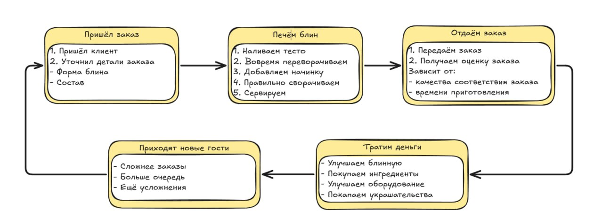

# Блинопёк — диздок

Рабочая версия от 14.10.2026. [Статус согласования](OPEN_QUESTIONS.md).

Мобильная игра про управление блинной. Игрок принимает заказы, вручную готовит блины и вкладывает заработок в ингредиенты, оборудование, помощников и оформление.

Основной режим, экономика и развитие следуют Good Pizza, Great Pizza. Приготовление блинов, лор, персонажи и их истории — собственные.

*Основной цикл игры. Исходная схема пользователя.*

### Состав игры

- Рабочие дни, гости, диалоги и заказы.
- Ручная готовка, оценка блюда, оплата, чаевые и возвраты.
- Расход ингредиентов, аренда, ремонт и итог дня.
- Открытие ингредиентов, улучшения, помощники и декор.
- Сюжетные визиты, повторные встречи и последствия решений.
- Обычная и премиальная валюты, реклама за награду и донат.

Сервер хранит прогресс пользователей, ведёт валютные операции и подтверждает рекламные награды и реальные покупки. Предусмотрены обновления и сезонный контент; состав конкретных сезонов разрабатывается отдельно. При обрыве связи игрок может закончить начатую смену и затем синхронизировать результат. Новая смена и покупки требуют подключения. Устройство систем описано в [архитектуре Unity и сервера](ARCHITECTURE.md).

Доставка, сад, отдельная система ежедневных заданий и социальные функции в этот объём не входят.

## Сущности обслуживания

| Сущность | Данные | Назначение |
| --- | --- | --- |
| Игрок | Кошелёк, открытия, покупки, запас инструментов, прогресс историй | Управляет готовкой и развитием. |
| Блинная | Рабочие станции, оборудование, оформление, рейтинг | Объединяет обслуживание и постоянный прогресс. |
| Рабочий день | Номер, игровое время, визиты, доходы и расходы | Одна смена с открытием, обслуживанием и итогом. |
| Посетитель | Внешность, реплики, терпение, текущий заказ, история | Формулирует просьбу, ждёт, оценивает результат. |
| Очередь | Порядок ожидающих и доступ к стойке | Гости обслуживаются последовательно. |
| Заказ | Гость, состав каждой порции, количество, форма, цена, лояльность | Хранит требования отдельно от реально приготовленного блюда. Лояльность действует только для текущего заказа. |
| Рецепт | Название, ингредиенты, их количество, форма | Определяет требуемый результат и запись в книге рецептов. |
| Оценка | Соответствие, отсутствие дырок, прожарка, форма, ожидание | Определяет реакцию, изменение лояльности, чаевые и возможный возврат. |
| Отзыв и рейтинг | Автор, оценка, текст, общий рейтинг | Фиксирует качество обслуживания и влияет на аренду. |
| Сюжетный визит | Условия появления, диалог, варианты ответа, последствия | Продвигает собственную историю посетителя. |

### Состояния

**Гость:** ожидание → разговор → ожидание блюда → реакция → уход. **Заказ:** принят → готовится → выдан либо отменён. **День:** открытие → обслуживание → закрытие → итог → покупки.

Один активный посетитель у стойки может заказать несколько блинов. Готовые блины остаются в заказе до складывания последнего; затем весь заказ сразу выдаётся гостю целиком. Очередь не означает одновременный приём независимых заказов.

## Сущности кухни и развития

| Сущность | Данные | Правило |
| --- | --- | --- |
| Тесто | Стоимость использования, нанесённая область | Покрывает круг сковороды и образует основу блина. |
| Начинка | Тип, способ нанесения, стоимость использования, покрытие или размещённые порции | Намазывается или накладывается порциями по трафарету на блин, лежащий на тарелке. |
| Трафарет начинки | Позиции размещения порций | Показывает, куда накладывать порционную начинку, по модели GPGP. |
| Блин | Покрытие тестом и наличие дырок, прожарка обеих сторон, фактические начинки, сгибы | Сохраняет результат каждого действия до выдачи или удаления. |
| Сковорода | Занятость, блин, стадия жарки, окно переворота | Ручка является кнопкой переворота. После переворота жарится вторая сторона. |
| Стол сборки | Тарелка с блином и доступные начинки | Рабочая поверхность для сборки блюда. |
| Тарелка | Содержимое и принадлежность заказу | На неё перекладывается блин со сковороды; затем на блин добавляются начинки. |
| Место удаления | Удаляемый блин | Позволяет начать блюдо заново с новым расходом продуктов. |
| Инструмент удаления начинки | Количество в запасе, цена за штуку | Маленький кулинарный скребок. Покупается поштучно за внутриигровую валюту. Один инструмент удаляет с блина всю начинку выбранного типа. |
| Книга рецептов | Открытые рецепты и составы | Справочник требований к блюдам. |
| Улучшение | Цена, условие доступа, эффект, куплено или нет | Постоянно меняет конкретное правило обслуживания или работы кухни. |
| Помощник начинки | Тип начинки, цена, условие доступа, куплено или нет, состояние включения | Автоматически наносит одну конкретную начинку. Для каждой начинки покупается отдельно. |
| Декор | Категория, слот, цена, принадлежность, установка | Меняет внешний вид выбранной части блинной. |
| Ремонт | Неисправность, последствия, стоимость | Восстанавливает состояние оборудования или помещения. |
| Покупка | Предмет, валюта, цена, результат | Списывает стоимость и выдаёт результат один раз. |

## Рабочий день и заказы

### Ход дня

Главное меню — фасад блинной. Кнопка начала смены запускает уровень и игровые часы. Гости подходят к стойке по очереди. Чем быстрее обслужен заказ, тем больше гостей можно принять за смену. После закрытия новые заказы не принимаются, текущий завершается. Цикл: **уровень → результат → главное меню (фасад)**. Магазин открывается отдельной иконкой на фасаде и закрывается обратно на фасад; следующий уровень начинается только по нажатию кнопки начала смены.

Одна смена — один уровень. Переигрывание неудачного дня не повышает уровень. Прогрессия и учебные эпизоды описаны в [документе обучения](PROGRESSION.md).

Первый заказ — безопасное обучение «Первый блин комом». В учебной демонстрации первый блин передерживается, игрок выбрасывает его в мусорку и готовит следующую попытку с правильным переворотом и снятием. Учебные ошибки не уменьшают деньги и терпение; во время чтения подсказок время и жарка остановлены. Обычные правила включаются со следующего заказа.

### Приём и уточнение

Гость формулирует заказ в диалоге: прямо, описанием категории ингредиентов или загадкой. Игрок принимает просьбу либо уточняет её. Уточнение снижает терпение. Текст заказа можно повторно посмотреть во время готовки. Сюжетный диалог может иметь собственные варианты ответа. [2]

Заказ задаёт количество блинов, состав каждого и форму складывания. Допускаются дополнительные ингредиенты, исключения и разные составы у нескольких порций. Система хранит точные требования независимо от того, насколько прямо они сформулированы в реплике.

### Ожидание

Терпение отображается рядом с гостем и уменьшается, пока выполняется его заказ. Долгое ожидание ухудшает результат обслуживания и может привести к уходу с возвратом денег. Улучшения влияют на скорость снижения терпения. [3]

### Генерация просьб

Новые ингредиенты расширяют возможные заказы. В стандартных просьбах используются открытые продукты. Сюжетные визиты появляются по условиям истории. Переносится устройство заказов GPGP, но тексты загадок, реплики и конкретные персонажи создаются для «Блинопёка».

### Результат

Гость сравнивает полученные порции с заказом. Учитываются состав, количество, отсутствие дырок в блине, приготовление, складывание и время ожидания. Дырки ухудшают оценку блюда. Результат выражается реакцией, изменением лояльности, чаевыми, возможным требованием возврата и отзывом.

Подгоревшие и неправильно собранные блины разрешено выдавать. Ошибки снижают лояльность посетителя в рамках текущего заказа: чем ниже лояльность, тем меньше чаевые. Лояльность не сохраняется между заказами и визитами. При сильном несоответствии заказу посетитель требует возврат денег. Зависимость размера чаевых от лояльности и численный порог возврата задаются при будущей балансировке.

## Приготовление блина

| Этап | Действие игрока | Результат |
| --- | --- | --- |
| Тесто | Проводит пальцем по сковороде и замазывает тестом круг без дырок, как соусом основу пиццы | На сковороде формируется блин |
| Обжаривание и переворот | Нажимает на ручку сковороды в нужный промежуток времени | Блин переворачивается; при опоздании подгорает |
| Вторая сторона | После переворота дожидается готовности второй стороны | Блин обжарен с двух сторон |
| Снятие со сковороды | После готовности второй стороны перекладывает блин на тарелку | Блин снят со сковороды и готов к добавлению начинки |
| Начинка | Намазывает начинку или перетаскивает порции на позиции трафарета на блине, лежащем на тарелке | На блине появляется слой или размещённые порции выбранной начинки |
| Складывание | Выполняет жесты для требуемой формы | Получается треугольник, конверт или трубочка |
| Выдача | После складывания последнего блина сразу передаёт весь заказ гостю | Гость оценивает весь заказ; отдельного украшения нет |

Контур теста — круг. Форма в заказе определяет складывание блина. Обе стороны обжариваются до переноса на тарелку; начинки добавляются уже на тарелке. Заказ из одного блина выдаётся сразу после его складывания. В заказе из нескольких блинов готовые порции ждут складывания последней, затем выдаётся весь заказ. Отдельной механики украшения блюда нет.

### Нанесение начинки

- Намазывание: игрок распределяет начинку по поверхности блина жестом.
- Накладывание: игрок перетаскивает порции начинки на позиции трафарета, как в GPGP.
- Если для выбранной начинки куплен и включён помощник, он автоматически наносит её соответствующим способом. Остальные начинки игрок наносит вручную.

| Начинка | Способ нанесения |
| --- | --- |
| Масло | Намазывание. |
| Варенье | Намазывание. |
| Мёд | Намазывание. |
| Творог | Накладывание порциями по трафарету. |
| Грибы | Накладывание порциями по трафарету. |

### Исправление начинки

Для удаления начинки нужен специальный расходуемый инструмент. Он покупается поштучно за внутриигровую валюту. Одно применение расходует один инструмент и удаляет с текущего блина всю начинку выбранного типа, независимо от количества нанесённых порций или площади намазанного слоя. Другие типы начинок остаются на блине.

Исправление начинки и использование инструмента доступны только до складывания. Сложенный блин нельзя развернуть или исправить, даже пока он ждёт готовности остальных блинов заказа.

### Начинки и формы

- Начинки: масло, варенье, творог, мёд, грибы.
- Формы: треугольник, конверт, трубочка.
- Тесто — основа блина. Состав и форма каждой порции задаются заказом.

Цены, тайминги, допустимое покрытие тестом, нормы начинки и пороги качества оставлены для будущей балансировки.

## Экономика

### Движение денег

Стоимость заказа начисляется при его принятии. При выдаче добавляются чаевые. Если гость требует возврат, деньги вычитаются из кошелька. Уже потраченные продукты остаются расходом. Повторная выдача одного заказа не создаёт повторную оплату. [3]

Исключение — первый безопасный учебный заказ: испорченная проба и повторные попытки не создают денежных потерь. Оплата успешного заказа начисляется только один раз.

Обычный ингредиент покупкой открывается для постоянного использования. Далее каждое фактическое использование стоит денег. Чем больше начинки игрок положил, тем выше расход. Отдельная закупка партии и резервирование порций не используются. Сад и его конечные запасы исключены. [1], [9]

### Расходы дня

| Статья | Условие списания |
| --- | --- |
| Продукты | По фактическому расходу теста и начинок, включая испорченные блюда. |
| Возвраты | При недовольстве гостя или срыве заказа. |
| Аренда | После рабочего дня; при действующей системе отзывов зависит от рейтинга. |
| Ремонт | При покупке восстановления неисправного объекта. |
| Развитие | При покупке ингредиента, улучшения, помощника или декора. |
| Инструменты удаления начинки | При покупке каждой штуки. Использование уменьшает запас инструментов без повторного списания денег. |

**Прибыль дня = выручка + чаевые − возвраты − продукты − аренда − оплаченный ремонт.** Покупки развития и расходуемых инструментов показываются отдельно. Итоговый отчёт суммирует проведённые операции и не списывает продукты второй раз.

### Рейтинг и неудачный день

Отзывы отражают обслуживание. Более высокий общий рейтинг уменьшает аренду, более низкий увеличивает её. [4] Если после обязательных расходов денег недостаточно для завершения дня, игрок повторяет этот день по модели GPGP. Постоянный прогресс предыдущих дней сохраняется. [5]

## Улучшения и декор

У каждого улучшения есть условие открытия, цена и один описанный эффект. Доступные покупки показываются в магазине развития. После покупки результат сохраняется между рабочими днями.

| Система GPGP | Механика в Блинопёке |
| --- | --- |
| Более частый приход гостей | Уменьшает промежуток между посетителями. |
| Удлинение рабочего дня | Отодвигает закрытие и позволяет обслужить больше гостей. |
| Улучшение терпения | Замедляет потерю терпения у посетителя. |
| Ускорение оборудования | Сокращает время готовки. Само по себе не автоматизирует действия. |
| Направляющие | Показывают область правильного нанесения или размещения. |
| Помощники начинок | Автоматизируют нанесение начинки. Для каждого типа начинки покупается отдельный помощник. |
| Отключение помощника | Возвращает ручное нанесение соответствующей начинки. Повторное включение не требует покупки. |

Это перенос функций основных улучшений GPGP. Работа оборудования и способы нанесения начинок адаптированы к готовке блинов. [6]

### Помощники начинок

Для каждой начинки предусмотрена отдельная постоянная покупка помощника. Покупка одного помощника автоматизирует только его начинку.

| Помощник | Действие |
| --- | --- |
| Масло | Автоматически намазывает масло. |
| Варенье | Автоматически намазывает варенье. |
| Мёд | Автоматически намазывает мёд. |
| Творог | Автоматически раскладывает порции творога по трафарету. |
| Грибы | Автоматически раскладывает порции грибов по трафарету. |

Игрок выбирает нужную начинку; купленный и включённый помощник выполняет её нанесение. Тесто наносится вручную, момент переворота и готовность второй стороны контролирует игрок, снятие со сковороды и складывание выполняются вручную.

### Ремонт

Между сменами появляются предложения исправить неисправности. Непочиненное оборудование ухудшает работу, неустранённые проблемы помещения создают дополнительные потери. Ремонт восстанавливает исходное состояние; покупка улучшения повышает возможности. [3]

### Оформление

Декор приобретается и устанавливается в соответствующий слот. Категории: фасад и вывеска, стены, пол, мебель, скатерти, посуда, освещение, предметы на стойке. Купленные варианты можно менять. Для обычного украшения не задаётся скрытый бонус к деньгам или качеству блюда.

Первый набор: по 1 базовому и 1 покупаемому варианту в каждой из 8 категорий. Всего 16 вариантов оформления; состав графики указан в [списке 2D-ассетов](ART_ASSETS.md).

Визуальное направление из презентации: тёплая небольшая блинная, деревянные поверхности, керамика, старая плита и фактурное оформление.

## Прогрессия истории и интерфейс

### Открытие контента

Условия прогресса связывают рабочие дни, сюжетные визиты и доступные покупки. Открытие начинки увеличивает набор заказов. Улучшения ускоряют обслуживание, заработок даёт доступ к следующим покупкам. Глава завершается выполнением своих условий, а не произвольно заданным числом успешных заказов. [1]

### Книга рецептов

Книга содержит открытые рецепты и категории ингредиентов. Она помогает расшифровать просьбу посетителя. Состав рецепта хранится отдельно от текста заказа. Механика фирменного блюда позволяет задать собственную комбинацию открытых ингредиентов, которую посетители затем заказывают. [7]

### Истории посетителей

Сюжетный визит содержит условие появления, реплики, ответ игрока, заказ или просьбу, последствия и условие следующей встречи. Сохраняются решения игрока, завершённые этапы и награды. Лор, имена, тексты и цепочки событий GPGP не переносятся. Содержание историй «Блинопёка» задаётся отдельно.

Первый набор посетителей: 6 обычных и 2 сюжетных — цветочница и путешественник. Утверждённые образы всех посетителей описаны в [списке 2D-ассетов](ART_ASSETS.md).

### Экраны

| Экран | Содержимое |
| --- | --- |
| Стойка | Гость, диалог, терпение, игровые часы, баланс, выдача. |
| Кухня | Круг для теста, сковорода с ручкой, начинки, стол и тарелка. |
| Заказ и книга рецептов | Исходная просьба и доступные рецепты. |
| Итог дня | Выручка, чаевые, возвраты, продукты, аренда, ремонт и прибыль. |
| Развитие | Ингредиенты, улучшения, помощники, ремонт и декор. |
| Отзывы | Отзывы посетителей и общий рейтинг. |
| Пауза и настройки | Продолжение, звук, выход из текущей игры. |

## Валюты реклама и донат

| Валюта и обозначение | Получение | Расход |
| --- | --- | --- |
| Обычная — монеты с блином | Оплата заказов, чаевые, сюжетные награды, рекламный бонус | Продукты, аренда, ремонт, ингредиенты, часть улучшений и декора. |
| Премиальная — янтарные капли мёда | Реклама за награду и покупка за реальные деньги | Помощники, отдельные улучшения, премиальный декор, обмен на обычную валюту. |

Используется модель валют мобильной GPGP. Обратный обмен обычной валюты на премиальную не предусмотрен. [8]

### Реклама за награду

- Предложение посмотреть ролик перед началом смены и в отдельном разделе рекламных наград даёт премиальную валюту.
- После рабочего дня ролик даёт дополнительную обычную валюту через увеличение чаевых.
- Игрок видит награду до запуска ролика. Награда выдаётся один раз после подтверждённого просмотра.
- Если ролик не загрузился или просмотр не завершён, награда не выдаётся. Продолжение игры остаётся доступным.

Количество просмотров и награды задаются параметрами. Лимиты учитывают реальный день, а не число пройденных смен. Точки показа и награды следуют модели GPGP. [8]

### Покупки за реальные деньги

Магазин предлагает наборы премиальной валюты и платный декоративный контент. Отдельный товар по модели GPGP — билеты получения рекламной награды без просмотра. Один билет заменяет один ролик. Цена и состав набора отображаются до покупки. [8], [10]

Подтверждённая транзакция выдаёт содержимое один раз. Отмена или ошибка не выдаёт товар. Купленный постоянный контент подлежит восстановлению. Смена или перезапуск дня не отменяют реальные покупки и уже полученные рекламные награды.

## Источники

### Материалы проекта

[Презентация «Блинопёк»](PRESENTATION.md), слайды 5–8; предоставленная схема игрового цикла; уточнения пользователя от 14.10.2026. Правила готовки и границы игры задаются этими уточнениями.

### Механики референса

[1]: https://www.goodpizzagreatpizza.com/press/ "TapBlaze — описание GPGP"

[2]: https://good-pizza-great-pizza.fandom.com/wiki/List_of_orders "GPGP Wiki — заказы и уточнения"

[3]: https://good-pizza-great-pizza.fandom.com/wiki/Profit "GPGP Wiki — доходы и расходы"

[4]: https://good-pizza-great-pizza.fandom.com/wiki/Pie_Chart_app "GPGP Wiki — отзывы и аренда"

[5]: https://www.nationhive.com/en/games/good-pizza-great-pizza/guide/how-make-profit "NationHive — прибыль и повтор дня"

[6]: https://good-pizza-great-pizza.fandom.com/wiki/Upgrades "GPGP Wiki — улучшения"

[7]: https://good-pizza-great-pizza.fandom.com/wiki/Recipe_Book "GPGP Wiki — книга рецептов"

[8]: https://good-pizza-great-pizza.fandom.com/wiki/Currency "GPGP Wiki — валюты и рекламные награды"

[9]: https://good-pizza-great-pizza.fandom.com/wiki/Ingredients/Cost_and_profit "GPGP Wiki — себестоимость ингредиентов"

[10]: https://www.google.com/ads/publisher/stories/tapblaze/ "Google for Publishers — монетизация TapBlaze"

Дата проверки источников: 14.10.2026. Wiki и NationHive — вторичные источники описания поведения игры. Точные внутренние формулы GPGP в документе не заявляются.

- [TapBlaze — описание GPGP](https://www.goodpizzagreatpizza.com/press/)
- [GPGP Wiki — заказы и уточнения](https://good-pizza-great-pizza.fandom.com/wiki/List_of_orders)
- [GPGP Wiki — доходы и расходы](https://good-pizza-great-pizza.fandom.com/wiki/Profit)
- [GPGP Wiki — отзывы и аренда](https://good-pizza-great-pizza.fandom.com/wiki/Pie_Chart_app)
- [NationHive — прибыль и повтор дня](https://www.nationhive.com/en/games/good-pizza-great-pizza/guide/how-make-profit)
- [GPGP Wiki — улучшения](https://good-pizza-great-pizza.fandom.com/wiki/Upgrades)
- [GPGP Wiki — книга рецептов](https://good-pizza-great-pizza.fandom.com/wiki/Recipe_Book)
- [GPGP Wiki — валюты и рекламные награды](https://good-pizza-great-pizza.fandom.com/wiki/Currency)
- [GPGP Wiki — себестоимость ингредиентов](https://good-pizza-great-pizza.fandom.com/wiki/Ingredients/Cost_and_profit)
- [Google for Publishers — монетизация TapBlaze](https://www.google.com/ads/publisher/stories/tapblaze/)
