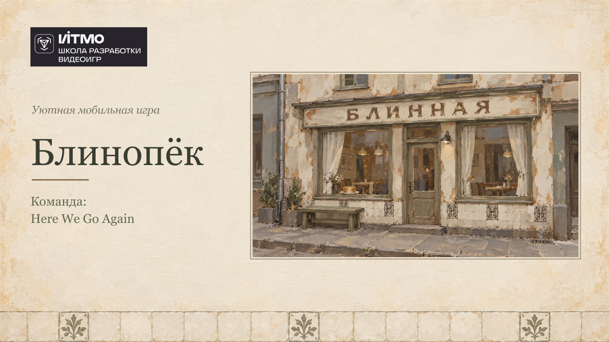
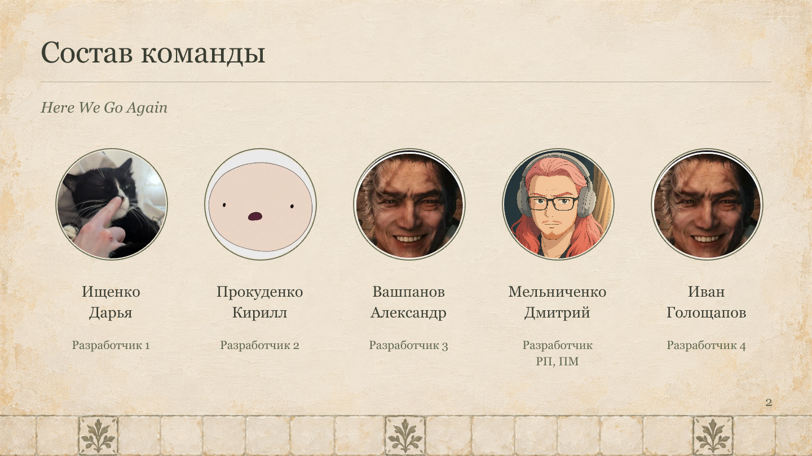
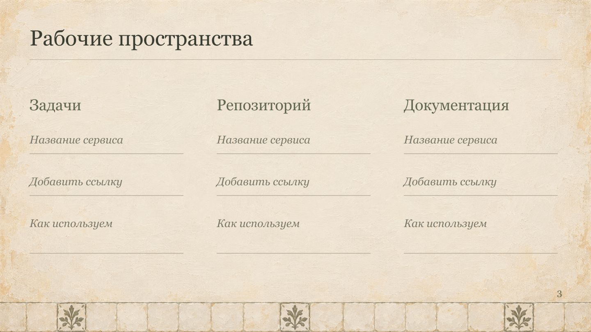
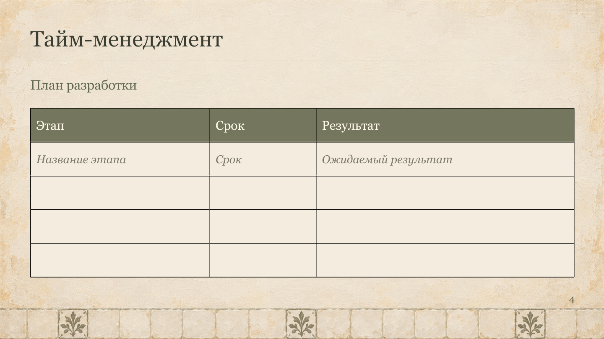
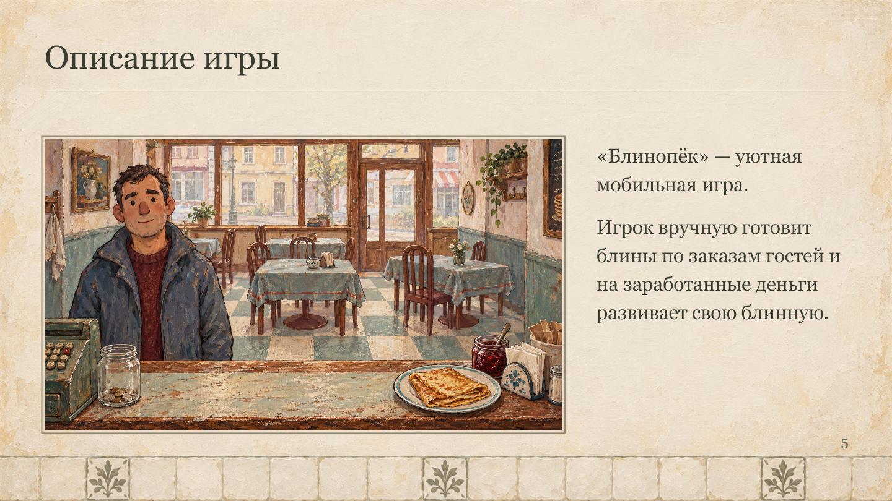
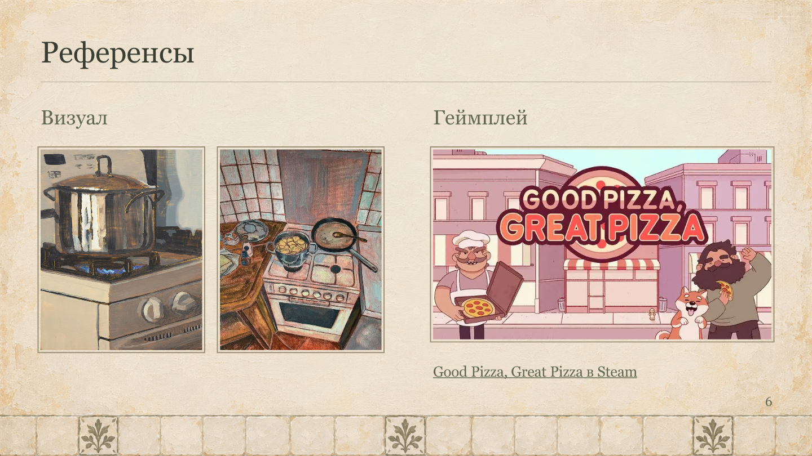
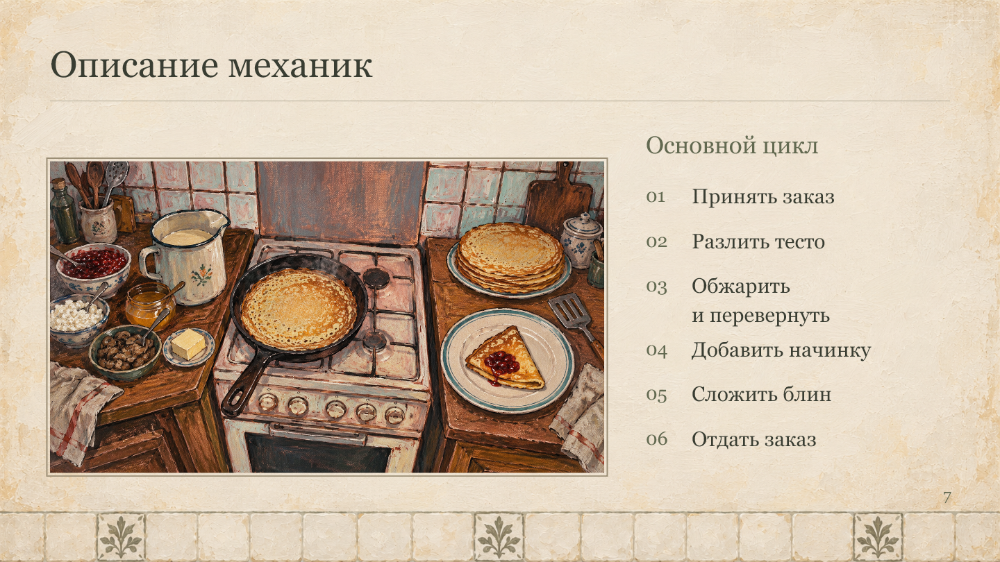
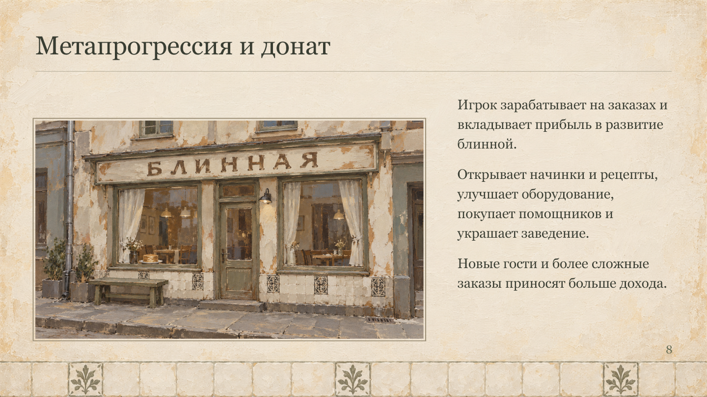
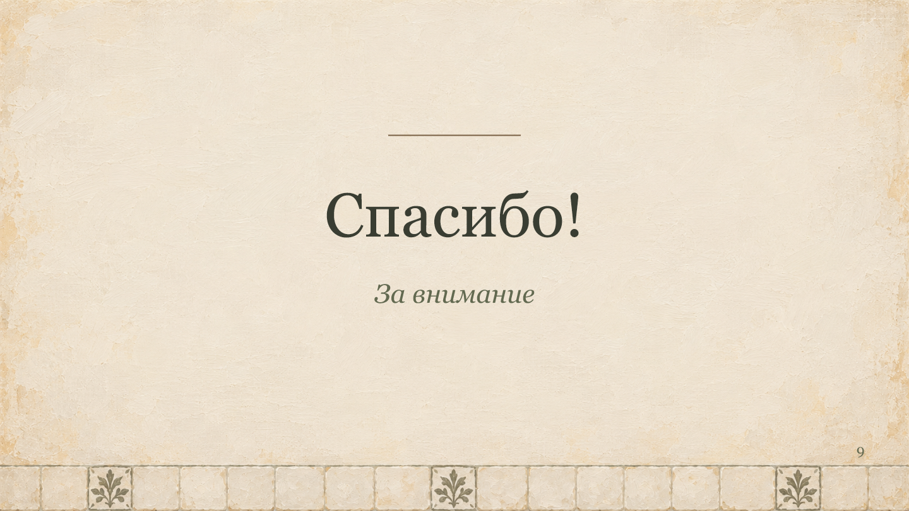

# Презентация Блинопёка

[Исходник PowerPoint](assets/sources/presentation.pptx). Для текущих правил игры см. [диздок](GAME_DESIGN.md).

## Слайды

### 1. Блинопёк

Команда:

Here We Go Again

Уютная мобильная игра

### 2. Состав команды

| Участник | Роль |
| --- | --- |
| Прокуденко Кирилл | Разработчик 2 |
| Вашпанов Александр | Разработчик 3 |
| Ищенко Дарья | Разработчик 1 |
| Мельниченко Дмитрий | Разработчик, РП, ПМ |
| Иван Голощапов | Разработчик 4 |

Команда: Here We Go Again.

### 3. Рабочие пространства

Категории: задачи, репозиторий, документация.

На исходном слайде остались поля «Название сервиса», «Добавить ссылку», «Как используем»; конкретные сервисы не указаны.

### 4. План разработки

| Этап | Срок | Результат |
| --- | --- | --- |
| Название этапа | Срок | Ожидаемый результат |

Это незаполненный шаблон плана из презентации.

### 5. Описание игры

«Блинопёк» — уютная мобильная игра.

Игрок вручную готовит блины по заказам гостей и на заработанные деньги развивает свою блинную.

### 6. Референсы

Визуал

Геймплей

Good Pizza, Great Pizza в Steam

### 7. Описание механик

1. Принять заказ.
2. Разлить тесто.
3. Обжарить и перевернуть.
4. Добавить начинку.
5. Сложить блин.
6. Отдать заказ.

### 8. Метапрогрессия и донат

Игрок зарабатывает на заказах и вкладывает прибыль в развитие блинной.

Открывает начинки и рецепты, улучшает оборудование, покупает помощников и украшает заведение.

Новые гости и более сложные заказы приносят больше дохода.

### 9. Завершение

Спасибо!

За внимание
